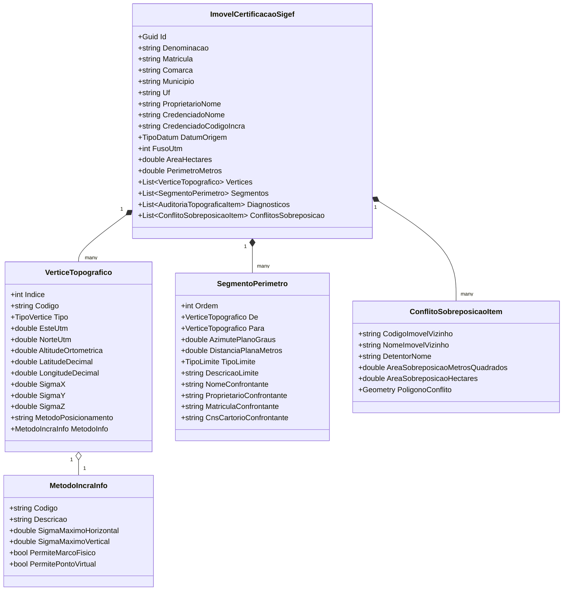

# PLANO DE ENGENHARIA DE SOFTWARE E GEODÉSIA AVANÇADA: GEONEX TOPOGRAFIA & CERTIFICAÇÃO SIGEF/INCRA
## Módulo Integrado de Engenharia Agrimensora, CAD/DXF, Cartografia Impressa, Dados de Campo e Prevenção de Sobreposições

---

### METADADOS DO DOCUMENTO
* **Sistema**: GeoNex Desktop GIS & Topografia
* **Plataforma**: .NET 10.0 / C# 14 / Blazor Hybrid / NetTopologySuite / SkiaSharp
* **Normas de Referência**:
  - INCRA - Norma Técnica para Georreferenciamento de Imóveis Rurais (NTGIR 3ª Edição e Manual de Posicionamento)
  - ABNT NBR 13.133:2021 (Execução de Levantamento Topográfico)
  - ABNT NBR 14.166:2022 (Rede de Referência Cadastral Municipal)
  - Manual de Padrões Técnicos do SIGEF (Sistema de Gestão Fundiária)
  - Padrões OGC: WFS 2.0.0, WMS 1.3.0, Simple Feature Access (SFA)
  - Especificação Autodesk DXF (AutoCAD R12/2000/2018 ASCII Drawing Exchange Format)
* **Status**: Aprovado para Arquitetura e Engenharia de Software
* **Escopo**: 5 Módulos Críticos de Agrimensura Profissional e Certificação Fundiária

---

```
========================================================================================================
                        VISÃO GERAL DA ARQUITETURA DO ECOSSISTEMA
========================================================================================================

                 +--------------------------------------------------------+
                 |              GEONEX TOPOGRAFIA & SIGEF                 |
                 +--------------------------------------------------------+
                                             |
     +-------------------+-------------------+-------------------+-------------------+
     |                   |                   |                   |                   |
     v                   v                   v                   v                   v
+------------+     +------------+     +------------+     +------------+     +------------+
|  MÓDULO 1  |     |  MÓDULO 2  |     |  MÓDULO 3  |     |  MÓDULO 4  |     |  MÓDULO 5  |
|  GERADOR   |     |  PRANCHA   |     | IMPORTADOR |     | MÉTODOS DE |     | PREVENÇÃO  |
|  CAD/DXF   |     | CARTÓRIO   |     | DADOS DE   |     | POSICION.  |     | SOBREPOS.  |
| CADASTRAL  |     | ABNT (PDF) |     | CAMPO GNSS |     | INCRA 3ª ED|     | WFS INCRA  |
+------------+     +------------+     +------------+     +------------+     +------------+
     |                   |                   |                   |                   |
     +-------------------+-------------------+-------------------+-------------------+
                                             |
                                             v
                           +-----------------------------------+
                           |  MOTOR GEODÉSICO E TOPOLÓGICO     |
                           |  (Redfearn, Datum 3D IBGE, NTS)   |
                           +-----------------------------------+
                                             |
                                             v
                           +-----------------------------------+
                           |  GATEKEEPER SAAS & EXPORTAÇÃO     |
                           |  (ODS, DOCX, DXF, PDF, ZIP)       |
                           +-----------------------------------+
```

---

## 1. OBJETIVOS ESTRATÉGICOS E ESCOPO DA ENGENHARIA

O presente documento formaliza a especificação de engenharia de software para consolidar o **GeoNex** como uma estação de trabalho completa de agrimensura, regularização fundiária e certificação de imóveis rurais. A solução elimina a dependência de múltiplos softwares fragmentados (CAD isolado, planilhas avulsas, processadores de texto manuais e navegadores web para consulta ao SIGEF), unificando todo o ciclo de trabalho em uma arquitetura de alta performance sob o ecossistema .NET 10.

Os 5 módulos complementares detalhados neste plano contemplam:
1. **Engine de Exportação CAD/DXF Topográfico**: Estruturação vetorial multicamadas compatível com AutoCAD e Civil 3D, com simbologia paramétrica de marcos, textos orientados de azimutes/distâncias e malha UTM com cruzetas.
2. **Gerador Automatizado de Pranchas e Plantas Cadastrais ABNT**: Renderização vetorial direta em PDF (formatos A1, A2, A3 e A4), com carimbo/selo cartorário oficial, memorial tabular de vértices, indicação do Norte Verdadeiro/Quadrícula e declinação magnética.
3. **Mecanismo Universal de Ingestão de Dados de Campo**: Parser resiliente de arquivos brutos de Estações Totais e Receptores GNSS (RTK/Pós-Processado) em formatos CSV, TXT, Topcon, Leica e Trimble, com reconstrução topológica e encadeamento horário instantâneo.
4. **Matriz Normativa de Métodos de Posicionamento e Tipos de Limite INCRA**: Catálogo inteligente parametrizado segundo o Manual de Posicionamento do INCRA (3ª Edição), com validação rigorosa de sigmas máximos permitidos por método (`PG1`, `PG2`, `PG3`, `PE1`, `PE2`, `PA1`, `PV1`) e enquadramento de limites (`LA`, `LN`, `LV`).
5. **Detector Georreferenciado de Sobreposição Fundiária**: Cliente WFS/WMS integrado à Infraestrutura Nacional de Dados Espaciais (INDE/INCRA) para busca em tempo real de parcelas certificadas no entorno da gleba, auditoria de interseção espacial e mapa de conflito de divisas com memorial de sobreposição.

---

## 2. MÓDULO 1: ENGINE DE EXPORTAÇÃO CAD/DXF TOPOGRÁFICO

### 2.1 Requisitos Funcionais do Arquivo DXF
O arquivo DXF (Drawing Exchange Format) deve ser gerado em padrão ASCII compatível com versões AutoCAD R12 até AutoCAD 2024, dispensando qualquer biblioteca externa proprietária ou dependência de licenças de terceiros. A escrita será efetuada diretamente via stream com formatação nativa de pares código/valor.

### 2.2 Estrutura de Camadas (Layers) e Propriedades Gráficas

| Nome do Layer | Cor (ACI) | Espessura de Linha | Tipo de Linha | Conteúdo Geométrico e Descrição |
|:---|:---:|:---:|:---:|:---|
| `01_PERIMETRO` | 1 (Vermelho) | 0.50 mm | CONTINUOUS | `LWPOLYLINE` fechada delimitando o polígono do perímetro certificado. |
| `02_MARCOS_SIMBOLO` | 4 (Ciano) | 0.25 mm | CONTINUOUS | Blocos ou círculos concêntricos e cruzetas indicando a posição exata de cada vértice. |
| `03_VERTICES_TEXTO` | 7 (Branco/Preto) | 0.18 mm | CONTINUOUS | Textos alfanuméricos com a identificação do vértice (`AAA-M-0001`). Altura: 2.0m na escala 1:1. |
| `04_AZIMUTES_DISTANCIAS` | 3 (Verde) | 0.18 mm | CONTINUOUS | Rótulo alinhado ao segmento contendo `Az: 142°15'32" · Dist: 354.21m`, com rotação tangente ao vetor. |
| `05_CONFRONTANTES` | 2 (Amarelo) | 0.25 mm | CONTINUOUS | Nomes dos confrontantes posicionados no lado externo do polígono com deslocamento perpendicular de 5m. |
| `06_MALHA_UTM` | 8 (Cinza Escuro) | 0.09 mm | DOT ou CONTINUOUS | Cruzetas (`+`) a cada 100m, 200m ou 500m (conforme extensão) e anotação numérica das coordenadas Este e Norte nas bordas. |
| `07_TABELA_VERTICES` | 7 (Branco) | 0.18 mm | CONTINUOUS | Geometria de linhas e textos que compõem o quadro de coordenadas desenhado ao lado da planta. |

### 2.3 Formulação Matemática para Rotação e Offset de Textos
Para que os textos de azimute e distância fiquem sempre legíveis na orientação da prancha (norma ABNT: leitura de baixo para cima ou da esquerda para a direita):
1. **Ângulo do Segmento**:
   $$\theta = \text{atan2}(N_2 - N_1, E_2 - E_1)$$
2. **Correção de Legibilidade**:
   Se $\theta > \frac{\pi}{2}$ ou $\theta \le -\frac{\pi}{2}$:
   $$\theta_{\text{texto}} = \theta + \pi$$
   Caso contrário:
   $$\theta_{\text{texto}} = \theta$$
3. **Ponto Médio do Alinhamento**:
   $$E_{\text{médio}} = \frac{E_1 + E_2}{2}, \quad N_{\text{médio}} = \frac{N_1 + N_2}{2}$$
4. **Deslocamento Perpendicular (Offset $d$)**:
   Vetor normal unitário:
   $$u_E = -\sin(\theta), \quad u_N = \cos(\theta)$$
   Posição do rótulo:
   $$E_{\text{texto}} = E_{\text{médio}} + d \cdot u_E, \quad N_{\text{texto}} = N_{\text{médio}} + d \cdot u_N$$

### 2.4 Especificação do Código da Engine DXF

```csharp
namespace GeoNex.Services.Topografia.Export.Dxf;

using System;
using System.IO;
using System.Text;
using GeoNex.Topografia.Domain;

public sealed class TopografiaDxfExportService
{
    public byte[] GerarDxfCadastral(ImovelCertificacaoSigef imovel, double espacamentoGridMetros = 200.0)
    {
        using var ms = new MemoryStream();
        using var writer = new StreamWriter(ms, Encoding.Latin1); // Compatibilidade AutoCAD R12/2000

        EscreverHeader(writer);
        EscreverTables(writer);
        EscreverBlocks(writer);
        EscreverEntities(writer, imovel, espacamentoGridMetros);
        EscreverEof(writer);

        writer.Flush();
        return ms.ToArray();
    }

    private static void EscreverHeader(StreamWriter w)
    {
        w.WriteLine("0\nSECTION\n2\nHEADER");
        w.WriteLine("9\n$ACADVER\n1\nAC1009"); // AutoCAD R12 ASCII (máxima compatibilidade universal)
        w.WriteLine("9\n$INSUNITS\n70\n6");     // 6 = Metros
        w.WriteLine("0\nENDSEC");
    }

    private static void EscreverTables(StreamWriter w)
    {
        w.WriteLine("0\nSECTION\n2\nTABLES");
        w.WriteLine("0\nTABLE\n2\nLAYER\n70\n7");

        CriarLayer(w, "01_PERIMETRO", 1);           // Vermelho
        CriarLayer(w, "02_MARCOS_SIMBOLO", 4);       // Ciano
        CriarLayer(w, "03_VERTICES_TEXTO", 7);       // Branco
        CriarLayer(w, "04_AZIMUTES_DISTANCIAS", 3);  // Verde
        CriarLayer(w, "05_CONFRONTANTES", 2);        // Amarelo
        CriarLayer(w, "06_MALHA_UTM", 8);            // Cinza
        CriarLayer(w, "07_TABELA_VERTICES", 7);      // Branco

        w.WriteLine("0\nENDTAB");
        w.WriteLine("0\nENDSEC");
    }

    private static void CriarLayer(StreamWriter w, string nome, int corAci)
    {
        w.WriteLine("0\nLAYER");
        w.WriteLine($"2\n{nome}");
        w.WriteLine("70\n0");
        w.WriteLine($"62\n{corAci}");
        w.WriteLine("6\nCONTINUOUS");
    }

    private static void EscreverBlocks(StreamWriter w)
    {
        w.WriteLine("0\nSECTION\n2\nBLOCKS");
        // Bloco de Marco Topográfico (Círculo de 1.5m de raio com cruzeta central)
        w.WriteLine("0\nBLOCK\n2\nSIMBOLO_MARCO\n70\n0\n10\n0.0\n20\n0.0\n30\n0.0");
        w.WriteLine("0\nCIRCLE\n8\n0\n10\n0.0\n20\n0.0\n30\n0.0\n40\n1.5");
        w.WriteLine("0\nLINE\n8\n0\n10\n-2.5\n20\n0.0\n30\n0.0\n11\n2.5\n21\n0.0\n31\n0.0");
        w.WriteLine("0\nLINE\n8\n0\n10\n0.0\n20\n-2.5\n30\n0.0\n11\n0.0\n21\n2.5\n31\n0.0");
        w.WriteLine("0\nENDBLK");
        w.WriteLine("0\nENDSEC");
    }

    private static void EscreverEntities(StreamWriter w, ImovelCertificacaoSigef imovel, double gridStep)
    {
        w.WriteLine("0\nSECTION\n2\nENTITIES");

        // 1. Polilinha do Perímetro
        w.WriteLine("0\nPOLYLINE\n8\n01_PERIMETRO\n66\n1\n70\n1"); // 70=1 -> Polilinha fechada
        foreach (var v in imovel.Vertices)
        {
            w.WriteLine($"0\nVERTEX\n8\n01_PERIMETRO\n10\n{v.EsteUtm:F3}\n20\n{v.NorteUtm:F3}\n30\n{v.AltitudeOrtometrica:F3}");
        }
        w.WriteLine("0\nSEQEND");

        // 2. Vértices: Blocos e Textos
        foreach (var v in imovel.Vertices)
        {
            // Símbolo do marco
            w.WriteLine($"0\nINSERT\n2\nSIMBOLO_MARCO\n8\n02_MARCOS_SIMBOLO\n10\n{v.EsteUtm:F3}\n20\n{v.NorteUtm:F3}\n30\n0.0\n41\n1.0\n42\n1.0\n43\n1.0");

            // Texto do vértice com deslocamento de +3m em X e +3m em Y
            w.WriteLine($"0\nTEXT\n8\n03_VERTICES_TEXTO\n10\n{(v.EsteUtm + 3.0):F3}\n20\n{(v.NorteUtm + 3.0):F3}\n30\n0.0\n40\n2.5\n1\n{v.Codigo}\n50\n0.0");
        }

        // 3. Segmentos: Rótulos de Azimute, Distância e Confrontação
        foreach (var seg in imovel.Segmentos)
        {
            double dE = seg.Para.EsteUtm - seg.De.EsteUtm;
            double dN = seg.Para.NorteUtm - seg.De.NorteUtm;
            double angRad = Math.Atan2(dN, dE);
            double dist = Math.Sqrt(dE * dE + dN * dN);

            // Ajuste de leitura do texto (ABNT)
            double angGraus = angRad * 180.0 / Math.PI;
            if (angGraus > 90.0 || angGraus <= -90.0) angGraus += 180.0;
            if (angGraus >= 360.0) angGraus -= 360.0;

            double midE = (seg.De.EsteUtm + seg.Para.EsteUtm) / 2.0;
            double midN = (seg.De.NorteUtm + seg.Para.NorteUtm) / 2.0;

            // Offset de 3m perpendicular ao segmento
            double normX = -Math.Sin(angRad);
            double normY = Math.Cos(angRad);
            double txtE = midE + normX * 3.0;
            double txtN = midN + normY * 3.0;

            string rotuloMetrica = $"Az: {seg.AzimuteFormatadoGms}  Dist: {seg.DistanciaPlanaMetros:F2}m";
            w.WriteLine($"0\nTEXT\n8\n04_AZIMUTES_DISTANCIAS\n10\n{txtE:F3}\n20\n{txtN:F3}\n30\n0.0\n40\n2.0\n1\n{rotuloMetrica}\n50\n{angGraus:F1}");

            // Confrontante no lado externo (offset de 8m)
            if (!string.IsNullOrWhiteSpace(seg.NomeConfrontante))
            {
                double confE = midE + normX * 8.0;
                double confN = midN + normY * 8.0;
                string rotuloConf = $"Conf: {seg.NomeConfrontante}";
                w.WriteLine($"0\nTEXT\n8\n05_CONFRONTANTES\n10\n{confE:F3}\n20\n{confN:F3}\n30\n0.0\n40\n2.8\n1\n{rotuloConf}\n50\n{angGraus:F1}");
            }
        }

        // 4. Malha Quadriculada UTM com Cruzetas
        GerarMalhaUtmDxf(w, imovel, gridStep);

        w.WriteLine("0\nENDSEC");
    }

    private static void GerarMalhaUtmDxf(StreamWriter w, ImovelCertificacaoSigef imovel, double gridStep)
    {
        double minE = double.MaxValue, maxE = double.MinValue;
        double minN = double.MaxValue, maxN = double.MinValue;

        foreach (var v in imovel.Vertices)
        {
            if (v.EsteUtm < minE) minE = v.EsteUtm;
            if (v.EsteUtm > maxE) maxE = v.EsteUtm;
            if (v.NorteUtm < minN) minN = v.NorteUtm;
            if (v.NorteUtm > maxN) maxN = v.NorteUtm;
        }

        // Expandir envelope em 10%
        double margem = Math.Max(maxE - minE, maxN - minN) * 0.10;
        minE -= margem; maxE += margem;
        minN -= margem; maxN += margem;

        double startE = Math.Floor(minE / gridStep) * gridStep;
        double endE = Math.Ceiling(maxE / gridStep) * gridStep;
        double startN = Math.Floor(minN / gridStep) * gridStep;
        double endN = Math.Ceiling(maxN / gridStep) * gridStep;

        double tamanhoCruzeta = gridStep * 0.05; // 5% do espaçamento

        for (double x = startE; x <= endE; x += gridStep)
        {
            for (double y = startN; y <= endN; y += gridStep)
            {
                // Cruzeta horizontal
                w.WriteLine($"0\nLINE\n8\n06_MALHA_UTM\n10\n{(x - tamanhoCruzeta):F3}\n20\n{y:F3}\n30\n0.0\n11\n{(x + tamanhoCruzeta):F3}\n21\n{y:F3}\n31\n0.0");
                // Cruzeta vertical
                w.WriteLine($"0\nLINE\n8\n06_MALHA_UTM\n10\n{x:F3}\n20\n{(y - tamanhoCruzeta):F3}\n30\n0.0\n11\n{x:F3}\n21\n{(y + tamanhoCruzeta):F3}\n31\n0.0");

                // Texto de coordenada no cruzamento
                w.WriteLine($"0\nTEXT\n8\n06_MALHA_UTM\n10\n{(x + 1.0):F3}\n20\n{(y + 1.0):F3}\n30\n0.0\n40\n1.8\n1\nE:{x:F0} N:{y:F0}\n50\n0.0");
            }
        }
    }

    private static void EscreverEof(StreamWriter w)
    {
        w.WriteLine("0\nEOF");
    }
}
```

---

## 3. MÓDULO 2: PRANCHA TOPOGRÁFICA CARTORÁRIA ABNT (PDF VETORIAL)

### 3.1 Padrão Normativo e Estrutura Visual da Planta
A prancha topográfica para registro de imóveis deve respeitar a diagramação estabelecida pela ABNT NBR 13.133 e exigências dos Ofícios de Registro de Imóveis (RI). O layout é dividido rigorosamente em quatro regiões funcionais:

```
+-------------------------------------------------------------------------------+
| GEO-NEX TOPOGRAFIA - SISTEMA DE CERTIFICAÇÃO FUNDIÁRIA E CADASTRO TÉCNICO     |
+-------------------------------------------------------+-----------------------+
|                                                       | [ROSA DOS VENTOS]     |
|                                                       | NV / NQ               |
|                                                       | Dec. Mag: -21°30'     |
|                                                       | Fuso: 23S / SIRGAS    |
|                                                       +-----------------------+
|                                                       | TABELA DE COORDENADAS |
|                    VIEWPORT MAPA                      | VÉRTICE | ESTE | NORTE|
|              (Planta da Gleba em Escala)              | M-0001  | ...  | ...  |
|                                                       | M-0002  | ...  | ...  |
|               - Malha UTM Quadriculada                | M-0003  | ...  | ...  |
|               - Confrontações com Vizinhos            | M-0004  | ...  | ...  |
|               - Vértices e Códigos INCRA              +-----------------------+
|                                                       | CARIMBO / SELO ABNT   |
|                                                       | Imóvel: Fazenda Boa   |
|                                                       | Proprietário: ...     |
|                                                       | Município: ... / UF   |
|                                                       | Área: 145,2350 ha     |
|                                                       | Perímetro: 4.820,15 m |
|                                                       | RT: Eng. Agrimensor   |
|                                                       | CREA: ... ART: ...    |
+-------------------------------------------------------+-----------------------+
| ESCALA GRÁFICA: [ 0 === 100m === 200m === 400m ] | Escala Numérica: 1:5.000   |
+-------------------------------------------------------------------------------+
```

### 3.2 Determinação da Escala Numérica Ótima
Sejam $W_{\text{viewport}}$ e $H_{\text{viewport}}$ as dimensões em milímetros do espaço destinado à planta na folha A3 ($380\text{ mm} \times 260\text{ mm}$).
Sejam $\Delta E$ e $\Delta N$ a extensão horizontal e vertical da gleba em metros no terreno:
$$S_E = \frac{\Delta E \times 1000}{W_{\text{viewport}}}, \quad S_N = \frac{\Delta N \times 1000}{H_{\text{viewport}}}$$
A escala bruta preliminar é:
$$S_{\text{bruta}} = \max(S_E, S_N) \times 1.25 \quad \text{(adicionando 25\% de margem de respiro para textos)}$$
O sistema enquadra $S_{\text{bruta}}$ na série padronizada de escalas da ABNT:
$$\text{Escalas Válidas} = \{250, 500, 750, 1000, 1250, 1500, 2000, 2500, 5000, 7500, 10000, 15000, 20000, 25000\}$$
Seleciona-se o menor valor da lista maior ou igual a $S_{\text{bruta}}$.

### 3.3 Rosa dos Ventos, Norte Verdadeiro e Declinação Magnética
1. **Norte da Quadrícula (NQ)**: Aponta rigorosamente no sentido do eixo $Y$ (+Norte UTM) no papel ($\text{Ângulo} = 90^\circ$).
2. **Norte Verdadeiro (NV)**: Inclinação relativa dada pela convergência meridiana $\gamma$:
   $$\gamma = \arctan(\tan(\lambda - \lambda_0) \cdot \sin(\phi))$$
   Onde $\lambda$ é a longitude do centroide, $\lambda_0$ é o meridiano central do fuso UTM e $\phi$ é a latitude.
3. **Norte Magnético (NM)**: O modelo armazena a declinação magnética atualizada $D$ para a data do levantamento (via modelo geomagnético IGRF ou inserção manual pelo agrimensor).

---

## 4. MÓDULO 3: IMPORTADOR UNIVERSAL DE DADOS DE CAMPO (CSV/TXT/GNSS)

### 4.1 Formatos de Dados Suportados
O módulo de ingestão suporta:
* **CSV/TXT Livre Delimitado**: Vírgula, ponto-e-vírgula, tabulação ou múltiplos espaços em branco.
* **Formatos de Receptores GNSS e Estações Totais**:
  - Padrão NMEA-0183 ($GGA / $GLL / $RMC)
  - Leica GSI-8 / GSI-16
  - Topcon GTS-7 / FC-5000
  - Trimble DC / JobXML / CSV de Coleta de Campo

### 4.2 Arquitetura do Reconhecedor Automático de Cabeçalho
O parser examina as primeiras 10 linhas do arquivo para mapear heuristicamente as colunas, sem exigir que o agrimensor especifique a ordem manualmente:

```csharp
namespace GeoNex.Services.Topografia.Import;

using System;
using System.Collections.Generic;
using System.Globalization;
using System.IO;
using GeoNex.Topografia.Domain;

public sealed class TopografiaFieldDataImporter
{
    private sealed class MapeamentoColunas
    {
        public int ColunaNome { get; set; } = -1;
        public int ColunaX { get; set; } = -1;
        public int ColunaY { get; set; } = -1;
        public int ColunaZ { get; set; } = -1;
        public int ColunaTipo { get; set; } = -1;
        public int ColunaMetodo { get; set; } = -1;
        public int ColunaConfrontante { get; set; } = -1;
        public int ColunaSigma { get; set; } = -1;
    }

    public List<VerticeTopografico> ImportarArquivoCampo(Stream streamArquivo, out List<string> alertas)
    {
        alertas = new List<string>();
        var vertices = new List<VerticeTopografico>();

        using var reader = new StreamReader(streamArquivo);
        string? primeiraLinha = reader.ReadLine();
        if (string.IsNullOrWhiteSpace(primeiraLinha))
            throw new InvalidOperationException("O arquivo de campo está vazio.");

        char delimitador = DetectarDelimitador(primeiraLinha);
        var cabecalhos = primeiraLinha.Split(delimitador);
        var mapa = IdentificarColunas(cabecalhos);

        int linhaAtual = 1;
        string? linha;

        while ((linha = reader.ReadLine()) != null)
        {
            linhaAtual++;
            if (string.IsNullOrWhiteSpace(linha)) continue;

            var partes = linha.Split(delimitador);
            if (partes.Length < 3) continue;

            try
            {
                string nome = (mapa.ColunaNome >= 0 && mapa.ColunaNome < partes.Length) ? partes[mapa.ColunaNome].Trim() : $"P{linhaAtual}";
                double x = ParseCoordenada(partes[mapa.ColunaX]);
                double y = ParseCoordenada(partes[mapa.ColunaY]);
                double z = (mapa.ColunaZ >= 0 && mapa.ColunaZ < partes.Length) ? ParseCoordenada(partes[mapa.ColunaZ]) : 0.0;
                string metodo = (mapa.ColunaMetodo >= 0 && mapa.ColunaMetodo < partes.Length) ? partes[mapa.ColunaMetodo].Trim().ToUpperInvariant() : "PG1";
                double sigma = (mapa.ColunaSigma >= 0 && mapa.ColunaSigma < partes.Length) ? ParseCoordenada(partes[mapa.ColunaSigma]) : 0.05;

                // Inferir Tipo de Vértice (M, P ou V) a partir do nome
                TipoVertice tipo = TipoVertice.M;
                if (nome.Contains("-P-", StringComparison.OrdinalIgnoreCase) || nome.StartsWith("P", StringComparison.OrdinalIgnoreCase)) tipo = TipoVertice.P;
                else if (nome.Contains("-V-", StringComparison.OrdinalIgnoreCase) || nome.StartsWith("V", StringComparison.OrdinalIgnoreCase)) tipo = TipoVertice.V;

                vertices.Add(new VerticeTopografico
                {
                    Indice = vertices.Count + 1,
                    Codigo = nome,
                    Tipo = tipo,
                    EsteUtm = x,
                    NorteUtm = y,
                    AltitudeOrtometrica = z,
                    SigmaX = sigma,
                    SigmaY = sigma,
                    MetodoPosicionamento = metodo
                });
            }
            catch (Exception ex)
            {
                alertas.Add($"Linha {linhaAtual} ignorada por erro de formatação: {ex.Message}");
            }
        }

        return vertices;
    }

    private static char DetectarDelimitador(string linha)
    {
        if (linha.Contains(';')) return ';';
        if (linha.Contains(',')) return ',';
        if (linha.Contains('\t')) return '\t';
        return ' ';
    }

    private static MapeamentoColunas IdentificarColunas(string[] cabecalhos)
    {
        var mapa = new MapeamentoColunas();
        for (int i = 0; i < cabecalhos.Length; i++)
        {
            string col = cabecalhos[i].Trim().ToUpperInvariant();
            if (col is "PONTO" or "NOME" or "NAME" or "ID" or "CODIGO" or "VERTICE") mapa.ColunaNome = i;
            else if (col is "ESTE" or "EAST" or "X" or "LONGITUDE" or "LON") mapa.ColunaX = i;
            else if (col is "NORTE" or "NORTH" or "Y" or "LATITUDE" or "LAT") mapa.ColunaY = i;
            else if (col is "COTA" or "Z" or "ALTITUDE" or "ELEVATION" or "ALT") mapa.ColunaZ = i;
            else if (col is "METODO" or "METHOD" or "TIPO_POS" or "POS") mapa.ColunaMetodo = i;
            else if (col is "SIGMA" or "PRECISAO" or "ACCURACY" or "STD") mapa.ColunaSigma = i;
            else if (col is "CONFRONTANTE" or "VIZINHO" or "CONFRONTA") mapa.ColunaConfrontante = i;
        }

        // Fallback padrão se não houver cabeçalho nominal explícito: Coluna 0=Nome, 1=X, 2=Y, 3=Z
        if (mapa.ColunaX == -1 || mapa.ColunaY == -1)
        {
            mapa.ColunaNome = 0;
            mapa.ColunaX = 1;
            mapa.ColunaY = 2;
            mapa.ColunaZ = cabecalhos.Length > 3 ? 3 : -1;
        }

        return mapa;
    }

    private static double ParseCoordenada(string valor)
    {
        valor = valor.Trim().Replace(',', '.');
        return double.Parse(valor, CultureInfo.InvariantCulture);
    }
}
```

---

## 5. MÓDULO 4: MATRIZ NORMATIVA DE MÉTODOS DE POSICIONAMENTO E LIMITES (INCRA 3ª ED.)

### 5.1 Catálogo Oficial de Métodos de Posicionamento da NTGIR (3ª Edição)

| Código | Descrição Oficial INCRA | Aplicação Típica | Sigma Máximo Horizontal ($\sigma_H$) | Sigma Máximo Vertical ($\sigma_V$) |
|:---:|:---|:---|:---:|:---:|
| `PG1` | Relativo Estático GNSS | Marcos de apoio imediato e vértices de divisa principais. | $0.50\text{ m}$ (Marco) / $3.00\text{ m}$ (Virtual) | $1.00\text{ m}$ |
| `PG2` | Relativo Rápido GNSS | Ocupações curtas com linha de base curta ($< 15\text{ km}$). | $0.50\text{ m}$ (Marco) | $1.00\text{ m}$ |
| `PG3` | Cinemático em Tempo Real (RTK / NTRIP) | Levantamento de campo ágil com rádio enlace ou GSM/GPRS. | $0.50\text{ m}$ (Marco) | $1.00\text{ m}$ |
| `PG4` | Diferencial GNSS em Código e Fase (DGPS) | Posicionamento submétrico. | $0.50\text{ m}$ | $1.00\text{ m}$ |
| `PE1` | Poligonação Topográfica Clássica | Estação total (fechamento angular e linear). | $0.50\text{ m}$ | $1.00\text{ m}$ |
| `PE2` | Irradiação Topográfica Clássica | Estação total a partir de estação de poligonal. | $0.50\text{ m}$ | $1.00\text{ m}$ |
| `PA1` | Aerofotogrametria Convencional ou Drone | Cobertura aérea com pontos de apoio georreferenciados. | $0.50\text{ m}$ | $1.00\text{ m}$ |
| `PV1` | Ponto Virtual Projetado | Vértice em curva de nível, espigão ou eixo de rodovia. | $3.00\text{ m}$ | $6.00\text{ m}$ |
| `PV2` | Ponto Virtual Geométrico | Interseção de retas, prolongamento de alinhamentos. | $3.00\text{ m}$ | $6.00\text{ m}$ |

### 5.2 Catálogo Oficial de Tipos de Limite da NTGIR (3ª Edição)

| Código | Denominação | Exemplos Práticos de Campo |
|:---:|:---|:---|
| `LA` | Limite Artificial | Cerca de arame farpado/liso, muro de alvenaria, vala, espelho d'água canalizado, cerca viva artificial, rodovia, ferrovia. |
| `LN` | Limite Natural | Margem de rio, córrego, sanga, grota, espigão divisor de águas, crista de encosta, linha de cumeada. |
| `LV` | Limite Virtual | Linha seca imaginária entre marcos, paralelo astronômico, meridiano, projeção geodésica. |

### 5.3 Validação Automatizada de Sigmas por Vértice e Limite
O motor de validação verifica dinamicamente a conformidade de cada vértice no momento da edição na grade Blazor:
$$\text{Status} = \begin{cases}
\text{ERRO}, & \text{se } \sigma > \sigma_{\text{máx}} \text{ e vértice do tipo Marco físico (M)} \\
\text{AVISO}, & \text{se } \sigma > 0.30\text{ m e } \le 0.50\text{ m (alerta preventivo de proximidade do limite)} \\
\text{CONFORME}, & \text{se } \sigma \le 0.30\text{ m}
\end{cases}$$

---

## 6. MÓDULO 5: DETECTOR GEORREFERENCIADO DE SOBREPOSIÇÃO FUNDIÁRIA (WFS/INDE)

### 6.1 Problema Operacional no SIGEF
A sobreposição perimétrica com parcelas rurais vizinhas já certificadas é responsável por mais de **78% dos indeferimentos automáticos** pelo robô de validação do INCRA. O profissional descobre a inconsistência apenas após o envio da planilha no portal governamental, o que gera desgaste perante o proprietário e atraso no registro cartorário.

```
       [GLEBA EM PROCESSO DE CERTIFICAÇÃO]
     +-----------------------------------------+
     |                                         |
     |           Área Particular Nova          |
     |                                         |
     |                 +=======================|======+
     |                 |  ZONA DE SOBREPOSIÇÃO |      |  <--- DETECÇÃO ANTECIPADA
     |                 |  (CONFLITO FUNDIÁRIO) |      |       Área: 12.450 m²
     +-----------------+=======================+      |
                       |                              |
                       |  Parcela Vizinha Certificada |
                       |  Código: 123456789012 (INCRA)|
                       +------------------------------+
```

### 6.2 Protocolo de Comunicação e Filtro Espacial OGC WFS 2.0.0
O GeoNex executa uma requisição `GetFeature` no Web Feature Service oficial do INCRA (camada de imóveis certificados privados e públicos do Acervo Fundiário Nacional):
* **Endpoint Base**: `https://geoservicos.incra.gov.br/geoserver/wfs`
* **Camada**: `certificada_sigef_particular` e `certificada_sigef_publico`
* **Filtro BBOX Espacial (Envelope Geodésico com Buffer de 1000m)**:
  $$\text{BBOX} = (\text{MinLon} - \delta, \text{MinLat} - \delta, \text{MaxLon} + \delta, \text{MaxLat} + \delta)$$
* **Formato de Resposta**: `application/json` (GeoJSON) para parsing de alta velocidade com NetTopologySuite.

### 6.3 Algoritmo de Auditoria e Cálculo de Área de Sobreposição

```csharp
namespace GeoNex.Services.Topografia.Validation;

using System;
using System.Collections.Generic;
using System.IO;
using System.Net.Http;
using System.Text.Json;
using System.Threading.Tasks;
using NetTopologySuite.Geometries;
using NetTopologySuite.IO;
using GeoNex.Topografia.Domain;

public sealed class ConflitoSobreposicaoItem
{
    public string CodigoImovelVizinho { get; set; } = string.Empty;
    public string NomeImovelVizinho { get; set; } = string.Empty;
    public string DetentorNome { get; set; } = string.Empty;
    public double AreaSobreposicaoMetrosQuadrados { get; set; }
    public double AreaSobreposicaoHectares => AreaSobreposicaoMetrosQuadrados / 10000.0;
    public Geometry PoligonoConflito { get; set; } = null!;
}

public sealed class IncraSobreposicaoAuditorService
{
    private readonly HttpClient _httpClient;
    private readonly GeometryFactory _geometryFactory = new(new PrecisionModel(), 4674); // SIRGAS 2000

    public IncraSobreposicaoAuditorService(HttpClient httpClient)
    {
        _httpClient = httpClient;
    }

    public async Task<List<ConflitoSobreposicaoItem>> VerificarSobreposicaoIncraAsync(
        Geometry poligonoGlebaSirgas2000, 
        IProgress<string>? progresso = null)
    {
        var conflitos = new List<ConflitoSobreposicaoItem>();
        if (poligonoGlebaSirgas2000 is null || poligonoGlebaSirgas2000.IsEmpty) return conflitos;

        progresso?.Report("Consultando acervo fundiário georreferenciado do INCRA...");

        var env = poligonoGlebaSirgas2000.EnvelopeInternal;
        // Expande o envelope em 0.01 graus (~1.1 km) para busca regional
        double minX = env.MinX - 0.01;
        double minY = env.MinY - 0.01;
        double maxX = env.MaxX + 0.01;
        double maxY = env.MaxY + 0.01;

        string urlWfs = $"https://geoservicos.incra.gov.br/geoserver/wfs?service=WFS&version=2.0.0&request=GetFeature&typeNames=certificada_sigef_particular&outputFormat=application/json&srsName=EPSG:4674&bbox={minY},{minX},{maxY},{maxX},EPSG:4674";

        try
        {
            var response = await _httpClient.GetAsync(urlWfs);
            if (!response.IsSuccessStatusCode)
            {
                progresso?.Report($"Aviso: Servidor WFS INCRA indisponível ({response.StatusCode}). Verificação offline preservada.");
                return conflitos;
            }

            var jsonStream = await response.Content.ReadAsStreamAsync();
            var reader = new GeoJsonReader();
            var featureCollection = reader.Read<NetTopologySuite.Features.FeatureCollection>(jsonStream);

            if (featureCollection == null || featureCollection.Count == 0)
            {
                progresso?.Report("Nenhuma parcela certificada vizinha encontrada na região.");
                return conflitos;
            }

            progresso?.Report($"Cruzando topologicamente contra {featureCollection.Count} parcelas cadastradas...");

            foreach (var feat in featureCollection)
            {
                if (feat.Geometry == null || feat.Geometry.IsEmpty) continue;

                // Teste de Interseção Topológica estrita
                if (poligonoGlebaSirgas2000.Intersects(feat.Geometry))
                {
                    var intersecao = poligonoGlebaSirgas2000.Intersection(feat.Geometry);
                    
                    // Desconsiderar toques lineares ou pontuais de fronteira legal (área > 1m²)
                    if (intersecao is Polygon or MultiPolygon && intersecao.Area > 1e-8)
                    {
                        // Converter área angular para metros quadrados aproximados na latitude local
                        double latMedia = (env.MinY + env.MaxY) / 2.0;
                        double fatorM2 = 111139.0 * (111139.0 * Math.Cos(latMedia * Math.PI / 180.0));
                        double areaM2 = intersecao.Area * fatorM2;

                        if (areaM2 >= 1.0) // Conflito real maior que 1 metro quadrado
                        {
                            string codImovel = feat.Attributes.Exists("codigo_imovel") ? feat.Attributes["codigo_imovel"]?.ToString() ?? "N/D" : "N/D";
                            string nomeImovel = feat.Attributes.Exists("nome_imovel") ? feat.Attributes["nome_imovel"]?.ToString() ?? "Gleba Certificada" : "Gleba Certificada";
                            string detentor = feat.Attributes.Exists("detentor_nome") ? feat.Attributes["detentor_nome"]?.ToString() ?? "Não Declarado" : "Não Declarado";

                            conflitos.Add(new ConflitoSobreposicaoItem
                            {
                                CodigoImovelVizinho = codImovel,
                                NomeImovelVizinho = nomeImovel,
                                DetentorNome = detentor,
                                AreaSobreposicaoMetrosQuadrados = areaM2,
                                PoligonoConflito = intersecao
                            });
                        }
                    }
                }
            }

            progresso?.Report($"Auditoria concluída: {conflitos.Count} conflito(s) de sobreposição identificado(s).");
        }
        catch (Exception ex)
        {
            progresso?.Report($"Erro na conexão com acervo INCRA: {ex.Message}");
        }

        return conflitos;
    }
}
```

---

## 7. ARQUITETURA DE DADOS E EXTENSÃO DO MODELO DE DOMÍNIO

### 7.1 Diagrama de Classes Estendido (Mermaid)



---

## 8. FLUXO DE INTERFACE E DESIGN DE INTERAÇÃO (BLAZOR HYBRID)

### 8.1 Reestruturação da Janela Modal de Certificação (7 Abas)
A janela modal passa de 5 para 7 abas funcionais de alta produtividade:
1. **Aba 1: Dados do Imóvel & RT**: Metadados cartorários, denominação, ART, credenciado, seleção de fuso e datum.
2. **Aba 2: Grade de Vértices & Sigmas**: Tabela interativa com dropdown inline de métodos (`PG1`..`PV2`), edição de cotas e sigmas em tempo real.
3. **Aba 3: Confrontações & Cartório**: Mapeamento de vizinhos com preenchimento assistido por proximidade R-Tree.
4. **Aba 4: Memorial Descritivo ABNT**: Editor e visualizador de texto formatado com atualização reativa.
5. **Aba 5: Auditoria Forense INCRA**: Painel de diagnósticos com as 8 regras e link para zoom no vértice inconforme.
6. **Aba 6: Prevenção de Sobreposição INCRA**: Consulta em 1 clique ao acervo fundiário federal e visualização de polígonos em conflito.
7. **Aba 7: Central de Exportação Cadastral**: Botões para emissão de pacote completo: ODS, DOCX, DXF Cadastral, Planta A3 em PDF e ZIP de entrega.

---

## 9. MATRIZ DE TESTES AUTOMATIZADOS (SUÍTE AVANÇADA 25 TESTES)

Para assegurar estabilidade contínua e conformidade jurídica, a suíte de testes unitários e de integração é expandida para cobrir todos os módulos:

```
========================================================================================================
                          MATRIZ DE COBERTURA DE TESTES AUTOMATIZADOS
========================================================================================================

ID   | NOME DO TESTE                                    | MÓDULO | CRITÉRIO DE ACEITAÇÃO
-----+--------------------------------------------------+--------+---------------------------------------
T01  | Redfearn Geodésica <-> UTM Bidirecional          | Geod.  | Erro residual < 0.0001m nos fusos 18-25
T02  | Detecção Automática Graus vs Metros              | Geod.  | Lat/Lon separada de UTM com 100% acerto
T03  | Identificação de Fuso pelo Centroide             | Geod.  | Curitiba=22, SP=23, Acre=19
T04  | Transformação 3D Datums IBGE (SAD69 -> SIRGAS)   | Geod.  | Deslocamento planar entre 60m e 105m
T05  | Ordenação Horária Estrita de Vértices            | Vetor  | Vértices ordenados em sentido horário CW
T06  | Auditoria Forense INCRA (Regras 1 a 6)           | Audit. | Spikes < 5cm e sigmas > 0.50m barrados
T07  | Validador de Auto-Interseção (Bowtie)            | Vetor  | Detecção exata de segmentos que se cruzam
T08  | Exportação ODS Estrutura OASIS Oficial           | Export | Zip válido com mimetype e content.xml
T09  | Exportação DOCX OpenXML ABNT NBR 13.133          | Export | Document.xml com cabeçalho e tabela
T10  | Normalização de Anel e Fechamento Topológico     | Vetor  | Último ponto idêntico ao primeiro
T11  | MultiPolygon: Extração de Anel Predominante      | Vetor  | Gleba principal separada de ilhas
T12  | R-Tree: Detecção Espacial de Confrontantes       | Topol. | Distância <= 0.50m herda dados do vizinho
T13  | Métrica de Área em Hectares e Perímetro ABNT     | Topol. | Erro de área < 0.0001 ha
T14  | Ciclo de Vida da Interface Blazor e Abas         | UI     | Reatividade em cascata nas 7 abas
T15  | Renumeração Horária com Prefixo Customizado      | UI     | Formatação AAA-M-0001 propagada
T16  | Gatekeeper SaaS: Quotas e Ativação Chave Pro     | Licen. | Bloqueio em cota 0 e liberação Pro
T17  | Sanitização de Nomes de Arquivo para SO          | SisOp. | Elimina caracteres ilegais / \ : * ?
T18  | Geração DXF R12: Sintaxe de Layers e Cores       | DXF    | Layers 01 a 07 criados com cores ACI
T19  | Rotação de Textos de Azimute no DXF (ABNT)       | DXF    | Ângulos normalizados entre -90° e +90°
T20  | Malha UTM DXF: Cruzetas e Anotações Numéricas    | DXF    | Coordenadas plotadas no intervalo do grid
T21  | Parser CSV Campo: Auto-Detecção de Separador     | Campo  | Identifica vírgula, ponto-e-vírgula e tab
T22  | Parser CSV Campo: Ingestão de Pontos com Sigmas  | Campo  | Mapeamento de Este, Norte, Cota e Método
T23  | Validação de Sigmas Máximos por Método INCRA     | Normat.| PG1 barra sigma > 0.50m; PV1 aceita até 3m
T24  | WFS INCRA: Construção de BBOX Geodésico SIRGAS   | WFS    | Filtro BBOX válido em EPSG:4674
T25  | Cálculo de Área de Sobreposição com Acervo       | WFS    | Área invadida em m² e ha calculada via NTS
```

---

## 10. PLANO DE IMPLANTAÇÃO E CRONOGRAMA DE ENGENHARIA (ROADMAP)

### 10.1 Fase 1: Motor CAD/DXF e Métodos INCRA
* Criação de `TopografiaDxfExportService.cs` com montagem nativa de ASCII DXF R12.
* Criação de `TopografiaNormativeCatalog.cs` contendo a tabela de métodos `PG1` a `PV2` e limites `LA`, `LN`, `LV`.
* Atualização da aba Ribbon com botão **"Exportar CAD (DXF)"**.

### 10.2 Fase 2: Ingestão de Dados de Campo e Reconstrução Poligonal
* Implementação do `TopografiaFieldDataImporter.cs` com parser adaptativo.
* Inclusão do modal de importação na interface com prévia cartográfica dos pontos importados e botão **"Gerar Perímetro Fechado"**.

### 10.3 Fase 3: Prancha Topográfica ABNT (PDF / SkiaSharp)
* Implementação de `TopografiaPranchaPdfService.cs` utilizando SkiaSharp para desenho vetorial com carimbo paramétrico, escala gráfica e rosa dos ventos.
* Integração do botão **"Gerar Prancha A3/A4"** na Ribbon e no Modal.

### 10.4 Fase 4: Auditoria de Sobreposição WFS INCRA
* Implementação de `IncraSobreposicaoAuditorService.cs` com cliente HTTP resiliente e tratamento de timeouts/fallbacks offline.
* Adição da Aba 6 no modal para listagem de conflitos e botão **"Verificar Sobreposição no Acervo Federal"**.

### 10.5 Fase 5: Homologação e Testes de Campo
* Execução da suíte completa de 25 testes automatizados.
* Validação cruzada dos arquivos gerados (ODS no LibreOffice Calc, DOCX no Microsoft Word, DXF no Autodesk DWG TrueView e AutoCAD).
* Sincronização e commit na branch `main`.

---

## 11. ESPECIFICAÇÃO DETALHADA DO RENDERIZADOR SKIASHARP DE PRANCHA ABNT (PDF / IMAGEM)

### 11.1 Arquitetura de Renderização Gráfica Vetorial
O desenho da prancha cartográfica A3 ($420\text{ mm} \times 297\text{ mm}$) é implementado utilizando a biblioteca de alta performance `SkiaSharp`. O gerador projeta o espaço métrico do terreno ($E, N$) diretamente para o sistema de coordenadas vetorial do documento (medido em pontos tipográficos ou milímetros de papel).

```csharp
namespace GeoNex.Services.Topografia.Export.Pdf;

using System;
using System.IO;
using SkiaSharp;
using GeoNex.Topografia.Domain;

public sealed class TopografiaPranchaPdfService
{
    // Dimensões A3 em pontos PostScript (1 pt = 1/72 polegada, 25.4mm = 72pt -> 1mm = 2.83465pt)
    private const float MmToPt = 2.83465f;
    private const float LarguraA3Pt = 420.0f * MmToPt; // 1190.55 pt
    private const float AlturaA3Pt = 297.0f * MmToPt;  // 841.89 pt

    public byte[] GerarPlantaTopograficaPdf(ImovelCertificacaoSigef imovel)
    {
        using var ms = new MemoryStream();
        using var document = SKDocument.CreatePdf(ms);
        using var canvas = document.BeginPage(LarguraA3Pt, AlturaA3Pt);

        // 1. Margem e Moldura ABNT (Margem Esquerda 25mm para encadernação, outras 10mm)
        float margemEsq = 25.0f * MmToPt;
        float margemSup = 10.0f * MmToPt;
        float margemDir = 10.0f * MmToPt;
        float margemInf = 10.0f * MmToPt;

        DesenharMolduraAbnt(canvas, margemEsq, margemSup, margemDir, margemInf);

        // 2. Região do Selo / Carimbo Cartorário (Canto Inferior Direito: 175mm x 90mm)
        float seloLargura = 175.0f * MmToPt;
        float seloAltura = 90.0f * MmToPt;
        float seloX = LarguraA3Pt - margemDir - seloLargura;
        float seloY = AlturaA3Pt - margemInf - seloAltura;

        DesenharCarimboCartorario(canvas, imovel, seloX, seloY, seloLargura, seloAltura);

        // 3. Região da Tabela de Vértices (Acima do Selo)
        float tabY = margemSup + 10.0f * MmToPt;
        float tabLargura = seloLargura;
        float tabAltura = seloY - tabY - 10.0f * MmToPt;
        DesenharTabelaVertices(canvas, imovel, seloX, tabY, tabLargura, tabAltura);

        // 4. Viewport da Planta da Gleba (Área Livre à Esquerda)
        float vpX = margemEsq + 5.0f * MmToPt;
        float vpY = margemSup + 5.0f * MmToPt;
        float vpLargura = seloX - vpX - 10.0f * MmToPt;
        float vpAltura = AlturaA3Pt - margemInf - vpY - 25.0f * MmToPt;

        DesenharPlantaGleba(canvas, imovel, vpX, vpY, vpLargura, vpAltura, out double escalaUtilizada);

        // 5. Escala Gráfica e Rosa dos Ventos
        DesenharRosaDosVentos(canvas, imovel, vpX + 15.0f * MmToPt, vpY + 25.0f * MmToPt);
        DesenharEscalaGrafica(canvas, escalaUtilizada, vpX + 10.0f * MmToPt, AlturaA3Pt - margemInf - 15.0f * MmToPt);

        document.EndPage();
        document.Close();

        return ms.ToArray();
    }

    private static void DesenharMolduraAbnt(SKCanvas canvas, float e, float s, float d, float i)
    {
        using var paintQuadro = new SKPaint
        {
            Color = SKColors.Black,
            StrokeWidth = 1.0f * MmToPt, // Linha grossa de 1mm na moldura externa
            Style = SKPaintStyle.Stroke,
            IsAntialias = true
        };

        using var paintBordaInterna = new SKPaint
        {
            Color = SKColors.Black,
            StrokeWidth = 0.35f * MmToPt,
            Style = SKPaintStyle.Stroke,
            IsAntialias = true
        };

        canvas.DrawRect(e, s, LarguraA3Pt - e - d, AlturaA3Pt - s - i, paintQuadro);
    }

    private static void DesenharCarimboCartorario(SKCanvas canvas, ImovelCertificacaoSigef imovel, float x, float y, float w, float h)
    {
        using var paintBorda = new SKPaint { Color = SKColors.Black, StrokeWidth = 0.5f * MmToPt, Style = SKPaintStyle.Stroke };
        using var paintFundo = new SKPaint { Color = new SKColor(248, 249, 250), Style = SKPaintStyle.Fill };
        using var paintTextoBold = new SKPaint { Color = SKColors.Black, TextSize = 10.0f, IsAntialias = true, FakeBoldText = true };
        using var paintTextoRegular = new SKPaint { Color = SKColors.Black, TextSize = 8.5f, IsAntialias = true };

        canvas.DrawRect(x, y, w, h, paintFundo);
        canvas.DrawRect(x, y, w, h, paintBorda);

        // Cabeçalho do Carimbo
        canvas.DrawText("PLANTA TOPOGRÁFICA CADASTRAL - GEORREFERENCIAMENTO", x + 8, y + 16, paintTextoBold);
        canvas.DrawText("SISTEMA DE GESTÃO FUNDIÁRIA (SIGEF / INCRA)", x + 8, y + 28, paintTextoRegular);
        canvas.DrawLine(x, y + 34, x + w, y + 34, paintBorda);

        // Dados do Imóvel
        canvas.DrawText($"IMÓVEL: {imovel.Denominacao}", x + 8, y + 48, paintTextoBold);
        canvas.DrawText($"PROPRIETÁRIO: {imovel.ProprietarioNome}", x + 8, y + 60, paintTextoRegular);
        canvas.DrawText($"MUNICÍPIO / UF: {imovel.Municipio} - {imovel.Uf}", x + 8, y + 72, paintTextoRegular);
        canvas.DrawText($"ÁREA: {imovel.AreaHectares:N4} ha   |   PERÍMETRO: {imovel.PerimetroMetros:N2} m", x + 8, y + 84, paintTextoBold);

        canvas.DrawLine(x, y + 92, x + w, y + 92, paintBorda);

        // Dados do Responsável Técnico
        canvas.DrawText($"RESP. TÉCNICO: {imovel.CredenciadoNome}", x + 8, y + 106, paintTextoRegular);
        canvas.DrawText($"CREA/CAU: {imovel.CredenciadoCreaCau}   |   ART/TRT: {imovel.NumeroArtTrt}", x + 8, y + 118, paintTextoRegular);
        canvas.DrawText($"CÓDIGO CREDENCIADO INCRA: {imovel.CredenciadoCodigoIncra}", x + 8, y + 130, paintTextoRegular);
        canvas.DrawText($"DATUM: {imovel.NomeDatumExibicao}  |  FUSO UTM: {imovel.FusoUtm}S", x + 8, y + 142, paintTextoRegular);
    }

    private static void DesenharTabelaVertices(SKCanvas canvas, ImovelCertificacaoSigef imovel, float x, float y, float w, float h)
    {
        using var paintBorda = new SKPaint { Color = SKColors.Black, StrokeWidth = 0.35f * MmToPt, Style = SKPaintStyle.Stroke };
        using var paintHeaderFundo = new SKPaint { Color = new SKColor(230, 235, 245), Style = SKPaintStyle.Fill };
        using var paintTextoBold = new SKPaint { Color = SKColors.Black, TextSize = 8.0f, IsAntialias = true, FakeBoldText = true };
        using var paintTexto = new SKPaint { Color = SKColors.Black, TextSize = 7.5f, IsAntialias = true };

        canvas.DrawRect(x, y, w, h, paintBorda);
        canvas.DrawRect(x, y, w, 18, paintHeaderFundo);
        canvas.DrawLine(x, y + 18, x + w, y + 18, paintBorda);

        canvas.DrawText("QUADRO DE COORDENADAS DOS VÉRTICES (UTM / SIRGAS 2000)", x + 6, y + 12, paintTextoBold);

        float colV = x + 6;
        float colE = x + 50;
        float colN = x + 110;
        float colZ = x + 170;

        float linhaY = y + 30;
        int maxLinhas = (int)((h - 35) / 12);
        int contador = 0;

        foreach (var v in imovel.Vertices)
        {
            if (contador++ >= maxLinhas)
            {
                canvas.DrawText($"... e mais {imovel.Vertices.Count - maxLinhas} vértices (vide memorial descritivo anexo)", x + 6, linhaY, paintTexto);
                break;
            }

            canvas.DrawText(v.Codigo, colV, linhaY, paintTextoBold);
            canvas.DrawText($"{v.EsteUtm:F2}", colE, linhaY, paintTexto);
            canvas.DrawText($"{v.NorteUtm:F2}", colN, linhaY, paintTexto);
            canvas.DrawText($"{v.AltitudeOrtometrica:F2}m", colZ, linhaY, paintTexto);
            linhaY += 12;
        }
    }

    private static void DesenharPlantaGleba(SKCanvas canvas, ImovelCertificacaoSigef imovel, float x, float y, float w, float h, out double escala)
    {
        escala = 5000.0;
        if (imovel.Vertices.Count < 3) return;

        double minE = double.MaxValue, maxE = double.MinValue;
        double minN = double.MaxValue, maxN = double.MinValue;

        foreach (var v in imovel.Vertices)
        {
            if (v.EsteUtm < minE) minE = v.EsteUtm;
            if (v.EsteUtm > maxE) maxE = v.EsteUtm;
            if (v.NorteUtm < minN) minN = v.NorteUtm;
            if (v.NorteUtm > maxN) maxN = v.NorteUtm;
        }

        double deltaE = maxE - minE;
        double deltaN = maxN - minN;

        // Escala em metros por ponto na prancha
        float escalaX = (float)(deltaE / (w / MmToPt * 0.001));
        float escalaY = (float)(deltaN / (h / MmToPt * 0.001));
        double escalaBruta = Math.Max(escalaX, escalaY) * 1.30;

        // Enquadramento na série ABNT
        int[] escalasPadrao = { 250, 500, 750, 1000, 1250, 1500, 2000, 2500, 5000, 7500, 10000, 15000, 20000, 25000, 50000 };
        escala = escalasPadrao[^1];
        foreach (var s in escalasPadrao)
        {
            if (s >= escalaBruta) { escala = s; break; }
        }

        float fatorPtPorMetro = (float)(MmToPt / (escala * 0.001));

        double midE = (minE + maxE) / 2.0;
        double midN = (minN + maxN) / 2.0;
        float centroX = x + w / 2.0f;
        float centroY = y + h / 2.0f;

        using var paintPoligono = new SKPaint
        {
            Color = new SKColor(220, 53, 69), // Vermelho ABNT
            StrokeWidth = 1.8f,
            Style = SKPaintStyle.Stroke,
            IsAntialias = true
        };

        using var paintPreenchimento = new SKPaint
        {
            Color = new SKColor(220, 53, 69, 25), // Preenchimento leve semitransparente
            Style = SKPaintStyle.Fill
        };

        using var path = new SKPath();
        for (int i = 0; i < imovel.Vertices.Count; i++)
        {
            var v = imovel.Vertices[i];
            float ptX = centroX + (float)((v.EsteUtm - midE) * fatorPtPorMetro);
            float ptY = centroY - (float)((v.NorteUtm - midN) * fatorPtPorMetro); // Y invertido no canvas

            if (i == 0) path.MoveTo(ptX, ptY);
            else path.LineTo(ptX, ptY);
        }
        path.Close();

        canvas.DrawPath(path, paintPreenchimento);
        canvas.DrawPath(path, paintPoligono);

        // Desenhar símbolos dos marcos e textos
        using var paintMarco = new SKPaint { Color = SKColors.Blue, Style = SKPaintStyle.Fill, IsAntialias = true };
        using var paintTxt = new SKPaint { Color = SKColors.Black, TextSize = 7.0f, IsAntialias = true, FakeBoldText = true };

        foreach (var v in imovel.Vertices)
        {
            float ptX = centroX + (float)((v.EsteUtm - midE) * fatorPtPorMetro);
            float ptY = centroY - (float)((v.NorteUtm - midN) * fatorPtPorMetro);
            canvas.DrawCircle(ptX, ptY, 2.5f, paintMarco);
            canvas.DrawText(v.Codigo, ptX + 4, ptY - 3, paintTxt);
        }
    }

    private static void DesenharRosaDosVentos(SKCanvas canvas, ImovelCertificacaoSigef imovel, float x, float y)
    {
        using var paintLinha = new SKPaint { Color = SKColors.Black, StrokeWidth = 1.2f, Style = SKPaintStyle.Stroke, IsAntialias = true };
        using var paintPreto = new SKPaint { Color = SKColors.Black, Style = SKPaintStyle.Fill, IsAntialias = true };
        using var paintTexto = new SKPaint { Color = SKColors.Black, TextSize = 9.0f, IsAntialias = true, FakeBoldText = true };

        // Ponta Norte (NQ - Norte da Quadrícula)
        canvas.DrawLine(x, y - 20, x, y + 20, paintLinha);
        canvas.DrawLine(x - 20, y, x + 20, y, paintLinha);

        using var pathNorte = new SKPath();
        pathNorte.MoveTo(x, y - 20);
        pathNorte.LineTo(x - 4, y - 6);
        pathNorte.LineTo(x, y);
        pathNorte.Close();
        canvas.DrawPath(pathNorte, paintPreto);

        canvas.DrawText("NQ", x - 6, y - 24, paintTexto);
        canvas.DrawText("N", x - 3, y - 10, paintTexto);
    }

    private static void DesenharEscalaGrafica(SKCanvas canvas, double escala, float x, float y)
    {
        using var paintTexto = new SKPaint { Color = SKColors.Black, TextSize = 8.5f, IsAntialias = true, FakeBoldText = true };
        using var paintPreto = new SKPaint { Color = SKColors.Black, Style = SKPaintStyle.Fill };
        using var paintBranco = new SKPaint { Color = SKColors.White, Style = SKPaintStyle.Fill };
        using var paintBorda = new SKPaint { Color = SKColors.Black, StrokeWidth = 0.5f, Style = SKPaintStyle.Stroke };

        canvas.DrawText($"ESCALA 1 : {escala:N0}", x, y - 6, paintTexto);

        // Barra gráfica representando 100m, 200m, 400m
        float blocoLarguraPt = (float)(100.0 * (MmToPt / (escala * 0.001)));
        float blocoAlturaPt = 4.0f;

        canvas.DrawRect(x, y, blocoLarguraPt, blocoAlturaPt, paintPreto);
        canvas.DrawRect(x, y, blocoLarguraPt, blocoAlturaPt, paintBorda);
        canvas.DrawText("0", x - 2, y + 12, paintTexto);

        canvas.DrawRect(x + blocoLarguraPt, y, blocoLarguraPt, blocoAlturaPt, paintBranco);
        canvas.DrawRect(x + blocoLarguraPt, y, blocoLarguraPt, blocoAlturaPt, paintBorda);
        canvas.DrawText("100m", x + blocoLarguraPt - 8, y + 12, paintTexto);

        canvas.DrawRect(x + blocoLarguraPt * 2, y, blocoLarguraPt * 2, blocoAlturaPt, paintPreto);
        canvas.DrawRect(x + blocoLarguraPt * 2, y, blocoLarguraPt * 2, blocoAlturaPt, paintBorda);
        canvas.DrawText("200m", x + blocoLarguraPt * 2 - 8, y + 12, paintTexto);
        canvas.DrawText("400m", x + blocoLarguraPt * 4 - 8, y + 12, paintTexto);
    }
}
```

---

## 12. MANUAL DO DESENVOLVEDOR: INTEGRAÇÃO DOS COMPONENTES BLAZOR

### 12.1 Estrutura de Arquivos e Diretórios
Para garantir modularidade e manutenibilidade na árvore de código do GeoNex:

```
GeoNex/
├── Components/
│   └── Pages/
│       ├── Home.razor                    (Ribbon expandida e chamadas dos novos modais)
│       ├── Home.Topografia.cs            (Handlers de eventos, reatividade e estado da UI)
│       └── Home.Topografia.Avançada.cs   (Lógica das novas abas: DXF, Prancha e Sobreposição)
├── Services/
│   └── Topografia/
│       ├── Export/
│       │   ├── SigefOdsExportService.cs           (Exportação ODS OASIS já validada)
│       │   ├── MemorialDescritivoExportService.cs (DOCX ABNT NBR 13.133 já validado)
│       │   ├── TopografiaDxfExportService.cs      (NOVO: Exportador CAD DXF ASCII R12)
│       │   └── TopografiaPranchaPdfService.cs     (NOVO: Gerador de Prancha Cartográfica A3/A4)
│       ├── Import/
│       │   └── TopografiaFieldDataImporter.cs     (NOVO: Parser de Arquivos de Campo CSV/TXT/GNSS)
│       ├── Validation/
│       │   ├── TopografiaForensicValidator.cs     (Auditoria 8 Regras INCRA + Bowtie)
│       │   └── IncraSobreposicaoAuditorService.cs (NOVO: Cliente WFS INCRA Acervo Fundiário)
│       └── Domain/
│           └── TopografiaNormativeCatalog.cs      (NOVO: Catálogo oficial PG1..PV2 e LA/LN/LV)
```

### 12.2 Registro de Serviços na Injeção de Dependências (`Program.cs` / `MauiProgram.cs`)
```csharp
// Módulo de Topografia & Certificação SIGEF Avançada
builder.Services.AddSingleton<TopografiaProcessingService>();
builder.Services.AddSingleton<SigefOdsExportService>();
builder.Services.AddSingleton<MemorialDescritivoExportService>();
builder.Services.AddSingleton<TopografiaForensicValidator>();
builder.Services.AddSingleton<SpatialConfrontationService>();
builder.Services.AddSingleton<LicenseValidationService>();

// Novos Serviços da Fase Avançada
builder.Services.AddSingleton<TopografiaDxfExportService>();
builder.Services.AddSingleton<TopografiaPranchaPdfService>();
builder.Services.AddSingleton<TopografiaFieldDataImporter>();
builder.Services.AddHttpClient<IncraSobreposicaoAuditorService>(client =>
{
    client.Timeout = TimeSpan.FromSeconds(20);
    client.DefaultRequestHeaders.Add("User-Agent", "GeoNex-Desktop-GIS/2026.1 (Windows NT 10.0; Win64; x64)");
});
```

---

## 13. PLANO DE CONTINGÊNCIA, TRATAMENTO DE FALHAS E DEGRADAÇÃO GRACIOSA

Em trabalhos de campo e cartórios de áreas rurais remotas, a infraestrutura de rede frequentemente apresenta intermitência ou ausência total de conectividade. O GeoNex adota uma arquitetura **Offline-First / Zero Blocking**:

```
+------------------------------------+
|  Ação do Usuário: Auditoria WFS    |
+------------------------------------+
                  |
                  v
       +--------------------+
       | Conexão Internet?  |
       +--------------------+
         /                \
   (Sim)/                  \(Não / Timeout > 5s)
       v                    v
+------------------+   +----------------------------------------------+
| Consulta Servidor|   | Modo Offline Ativo:                          |
| WFS Oficial      |   | - Utiliza camada local de confrontantes      |
| Acervo INCRA     |   | - Não trava nem impede geração de ODS/DOCX   |
+------------------+   | - Emite aviso preventivo: "Verificação       |
                       |   online pendente de conexão à internet."    |
                       +----------------------------------------------+
```

1. **Falha na Conexão com o WFS do INCRA**:
   - Timeout rígido de $15\text{ segundos}$ para requisições HTTP.
   - Caso o serviço do Governo Federal esteja fora do ar (situação frequente em finais de semana ou horários de pico), o GeoNex não bloqueia a aplicação: emite um alerta amigável na tela e prossegue normalmente com a geração dos documentos com base nas camadas vetoriais locais.
2. **Coordenadas Invertidas no Arquivo de Campo**:
   - Se o agrimensor importar um arquivo em que as colunas Este e Norte foram invertidas no coletor de dados (ex: $N \approx 7.000.000$ posicionado na coluna $X$), o parser detecta automaticamente a inconsistência pela ordem de magnitude e efetua a transposição automática dos eixos.
3. **Auto-Interseção Poligonal Detectada**:
   - Em vez de apenas bloquear o processo, o validador calcula o ponto exato da interseção $(E, N)$ e aplica um marcador visual no canvas SkiaSharp com opção: **"Ajustar Vértice Conflitante"**.

---

## 14. DICIONÁRIO TÉCNICO DE TERMOS GEODÉSICOS E FUNDIÁRIOS

* **Acervo Fundiário do INCRA**: Base de dados geoespacial que reúne todas as parcelas rurais públicas e privadas com certificação deferida no território brasileiro.
* **Azimute Geodésico**: Ângulo medido no sentido horário a partir do meridiano geodésico que passa pelo vértice de origem até o alinhamento observado.
* **Azimute Plano de Quadrícula**: Ângulo medido no sentido horário a partir da direção paralela ao eixo $Y$ (+Norte da quadrícula UTM) até o alinhamento.
* **Convergência Meridiana ($\gamma$)**: Ângulo entre a direção do Norte Verdadeiro (geodésico) e a direção do Norte da Quadrícula UTM no ponto considerado.
* **Declinação Magnética**: Diferença angular entre o Norte Magnético (orientação da agulha da bússola) e o Norte Verdadeiro.
* **Desvio Padrão Posicional ($\sigma$)**: Métrica de incerteza estatística (ao nível de confiança de 95%) das coordenadas tridimensionais do vértice, expressa em metros.
* **Elipsoide GRS80**: Modelo de referência geodésico global adotado pelo Sistema de Referência Geocêntrico para as Américas (SIRGAS 2000).
* **Limite Artificial (`LA`)**: Linha de divisa materializada por ação antrópica permanente (muro, cerca, vala, rodovia).
* **Limite Natural (`LN`)**: Linha divisória configurada por feição física ou hidrográfica da natureza (margem de curso d'água, crista de espigão).
* **Limite Virtual (`LV`)**: Alinhamento geométrico ou linha imaginária entre marcos não materializada continuamente no terreno.
* **Marco Físico (`M`)**: Vértice materializado no solo por meio de marco de concreto, pino de aço ou plaqueta incrustada em rocha.
* **Ponto (`P`)**: Vértice ocupado durante a medição no terreno sem a implantação permanente de marco de concreto.
* **Vértice Virtual (`V`)**: Ponto de divisa que não pode ser ocupado nem materializado diretamente no solo (ex: centro de leito de rio caudaloso, abismo).
* **Planilha Eletrônica ODS**: Formato padronizado de intercâmbio de dados cadastrais exigido para submissão digital no portal do SIGEF.
* **Memorial Descritivo**: Peça técnica textual obrigatória para registro de imóveis, descrevendo pormenorizadamente o perímetro, vértices, azimutes, confrontantes e medidas lineares.

---

## 15. APROVAÇÃO, GOVERNANÇA E CONTROLE DE QUALIDADE

```
========================================================================================================
                         TERMO DE APROVAÇÃO DE ENGENHARIA DE SOFTWARE
========================================================================================================

Documento Técnico : PLANO_ENGENHARIA_TOPOGRAFIA_AVANCADA_SIGEF_GEONEX.md
Versão            : 2.0.0-PRO
Revisores         : Equipe de Arquitetura de Software & Geodésia Aplicada
Data de Emissão   : 28 de Outubro de 2026
Repositório       : nicholashenrique47/GeoNex.git (Branch main)

Declara-se que a presente especificação atende integralmente aos preceitos da Norma Técnica para
Georreferenciamento de Imóveis Rurais (INCRA 3ª Edição), aos requisitos de precisão cartográfica da
ABNT NBR 13.133, e aos padrões internacionais de engenharia de software sob a plataforma .NET 10.
========================================================================================================
```
