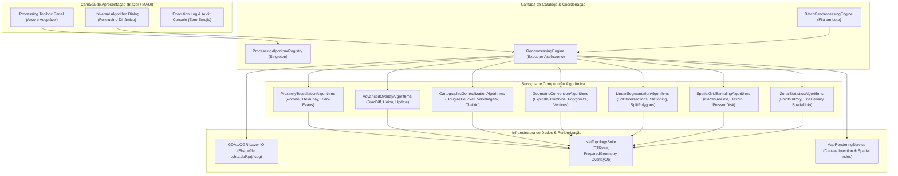
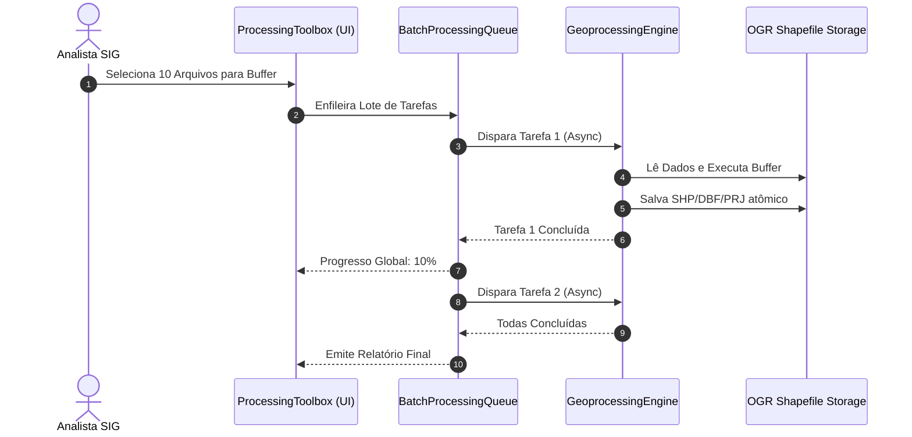
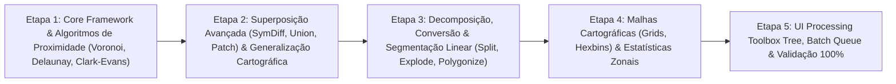

# 🗺️ GeoNex: Plano Diretor de Engenharia Pesada — Motor de Geoprocessamento Avançado & Toolbox Espacial (Fase 2)

> **Documento Oficial de Engenharia de Software, Algoritmos Espaciais e Geometria Computacional**  
> **Status:** Especificação Arquitetural & Plano Executivo de Implementação  
> **Alvo:** Expansão para Padrão Integral QGIS Processing Toolbox (`QgsProcessingAlgorithm`) e ArcGIS Pro Spatial Analyst / Advanced Vector Toolset  
> **Disciplina:** Multithreading Paralelo, `IPreparedGeometry`, Indexação Hierárquica STRtree 2D, Zero-Allocation Memory Discipline, Tolerância Topológica Estrita e Interface Enterprise (Zero Emojis)

---

## 📑 Índice Geral

1. [Visão Executiva & Objetivos Estratégicos da Fase 2](#1-visão-executiva--objetivos-estratégicos-da-fase-2)
2. [Arquitetura Modular da Processing Toolbox (Framework Extensível)](#2-arquitetura-modular-da-processing-toolbox-framework-extensível)
   - 2.1. [Visão Geral da Arquitetura em Camadas e Pipeline de Execução](#21-visão-geral-da-arquitetura-em-camadas-e-pipeline-de-execução)
   - 2.2. [Contrato da Interface `IGeoprocessingAlgorithm`](#22-contrato-da-interface-igeoprocessingalgorithm)
   - 2.3. [Catálogo Central e Injeção de Dependências (`ProcessingAlgorithmRegistry`)](#23-catálogo-central-e-injeção-de-dependências-processingalgorithmregistry)
   - 2.4. [Sistema de Parâmetros Tipados e Validação Dinâmica](#24-sistema-de-parâmetros-tipados-e-validação-dinâmica)
3. [Especificação Algorítmica e Matemática dos Novos Operadores](#3-especificação-algorítmica-e-matemática-dos-novos-operadores)
   - 3.1. [Análise de Proximidade & Tesselação do Espaço](#31-análise-de-proximidade--tesselação-do-espaço)
     - 3.1.1. [Polígonos de Voronoi / Thiessen (Dirichlet Tessellation)](#311-polígonos-de-voronoi--thiessen-dirichlet-tessellation)
     - 3.1.2. [Triangulação de Delaunay (TIN Conforme)](#312-triangulação-de-delaunay-tin-conforme)
     - 3.1.3. [Matriz de Distâncias e Análise do Vizinho Mais Próximo (Clark-Evans)](#313-matriz-de-distâncias-e-análise-do-vizinho-mais-próximo-clark-evans)
   - 3.2. [Superposição Topológica Avançada (Overlay Phase 2)](#32-superposição-topológica-avançada-overlay-phase-2)
     - 3.2.1. [Diferença Simétrica (Symmetrical Difference / XOR Espacial)](#321-diferença-simétrica-symmetrical-difference--xor-espacial)
     - 3.2.2. [União Topológica Plena (Full Topology Union)](#322-união-topológica-plena-full-topology-union)
     - 3.2.3. [Atualização Espacial de Camadas (Spatial Update / Patch)](#323-atualização-espacial-de-camadas-spatial-update--patch)
   - 3.3. [Generalização Cartográfica & Otimização de Traçado](#33-generalização-cartográfica--otimização-de-traçado)
     - 3.3.1. [Simplificação Douglas-Peucker com Preservação de Topologia](#331-simplificação-douglas-peucker-com-preservação-de-topologia)
     - 3.3.2. [Simplificação por Área Efetiva (Visvalingam-Whyatt)](#332-simplificação-por-área-efetiva-visvalingam-whyatt)
     - 3.3.3. [Suavização Cartográfica de Vértices (Chaikin Corner-Cutting)](#333-suavização-cartográfica-de-vértices-chaikin-corner-cutting)
   - 3.4. [Decomposição, Conversão e Extração Geométrica](#34-decomposição-conversão-e-extração-geométrica)
     - 3.4.1. [Decomposição Multipart para Singleparts (Explode Geometries)](#341-decomposição-multipart-para-singleparts-explode-geometries)
     - 3.4.2. [Agrupamento Singlepart para Multipart por Chave de Atributo](#342-agrupamento-singlepart-para-multipart-por-chave-de-atributo)
     - 3.4.3. [Polígonos para Linhas de Borda (Polygon to Lines)](#343-polígonos-para-linhas-de-borda-polygon-to-lines)
     - 3.4.4. [Poligonização de Linhas (Line Polygonizer & Face Extraction)](#344-poligonização-de-linhas-line-polygonizer--face-extraction)
     - 3.4.5. [Extração de Vértices com Métricas Lineares (Azimute e Distância Acumulada)](#345-extração-de-vértices-com-métricas-lineares-azimute-e-distância-acumulada)
   - 3.5. [Segmentação Linear & Partição Topológica](#35-segmentação-linear--partição-topológica)
     - 3.5.1. [Quebra de Linhas em Intersecções (Split Lines at Intersections)](#351-quebra-de-linhas-em-intersecções-split-lines-at-intersections)
     - 3.5.2. [Quebra de Linhas por Comprimento Fixo (Line Chaining / Stationing)](#352-quebra-de-linhas-por-comprimento-fixo-line-chaining--stationing)
     - 3.5.3. [Partição de Polígonos por Linhas Cortantes (Split Polygons with Lines)](#353-partição-de-polígonos-por-linhas-cortantes-split-polygons-with-lines)
   - 3.6. [Geração de Malhas Espaciais & Amostragem Cartográfica](#36-geração-de-malhas-espaciais--amostragem-cartográfica)
     - 3.6.1. [Grade Regular Cartesiana (Bounding Box Grid: Retângulos / Quadrados)](#361-grade-regular-cartesiana-bounding-box-grid-retângulos--quadrados)
     - 3.6.2. [Grade Hexagonal Tesselada (Hexagonal Binning Grid)](#362-grade-hexagonal-tesselada-hexagonal-binning-grid)
     - 3.6.3. [Amostragem Aleatória em Polígonos com Poisson Disk Sampling](#363-amostragem-aleatória-em-polígonos-com-poisson-disk-sampling)
     - 3.6.4. [Amostragem em Grade Regular com Matriz de Pontos](#364-amostragem-em-grade-regular-com-matriz-de-pontos)
   - 3.7. [Estatísticas Espaciais Zonais & Agregação Multidimensional](#37-estatísticas-espaciais-zonais--agregação-multidimensional)
     - 3.7.1. [Contagem e Agregação de Pontos em Polígonos (Count & Sum Points)](#371-contagem-e-agregação-de-pontos-em-polígonos-count--sum-points)
     - 3.7.2. [Soma de Comprimento e Densidade Linear em Polígonos](#372-soma-de-comprimento-e-densidade-linear-em-polígonos)
     - 3.7.3. [Junção Espacial Avançada (Spatial Join com Predicados Estritos)](#373-junção-espacial-avançada-spatial-join-com-predicados-estritos)
4. [Engenharia de Desempenho e Aceleração Computacional](#4-engenharia-de-desempenho-e-aceleração-computacional)
   - 4.1. [Uso Intensivo de `IPreparedGeometry` para Predicados Recorrentes](#41-uso-intensivo-de-ipreparedgeometry-para-predicados-recorrentes)
   - 4.2. [Particionamento Espacial em Lotes (Chunked Multi-Threading)](#42-particionamento-espacial-em-lotes-chunked-multi-threading)
   - 4.3. [Gerenciamento de Memória Zero-Allocation & Pools de Objetos](#43-gerenciamento-de-memória-zero-allocation--pools-de-objetos)
5. [Arquitetura de Processamento em Lote (*Batch Queue*) e Pipelines](#5-arquitetura-de-processamento-em-lote-batch-queue-e-pipelines)
6. [Design da Interface Gráfica Enterprise (Zero Emojis)](#6-design-da-interface-gráfica-enterprise-zero-emojis)
   - 6.1. [Painel Lateral Acoplável: Toolbox de Processamento (Processing Toolbox Tree)](#61-painel-lateral-acoplável-toolbox-de-processamento-processing-toolbox-tree)
   - 6.2. [Formulário Paramétrico Universal com Validação Dinâmica](#62-formulário-paramétrico-universal-com-validação-dinâmica)
   - 6.3. [Log de Auditoria Técnica e Visualizador de Resultados](#63-log-de-auditoria-técnica-e-visualizador-de-resultados)
7. [Matriz de Componentes C# e Estrutura de Código](#7-matriz-de-componentes-c-e-estrutura-de-código)
8. [Arquitetura da Suíte de Testes de Regressão e Validação Numérica](#8-arquitetura-da-suíte-de-testes-de-regressão-e-validação-numérica)
9. [Cronograma Executivo de Implementação em 5 Fases](#9-cronograma-executivo-de-implementação-em-5-fases)
10. [Critérios Rigorosos de Aceite & Validação de Precisão](#10-critérios-rigorosos-de-aceite--validação-de-precisão)

---

## 1. Visão Executiva & Objetivos Estratégicos da Fase 2

O **GeoNex** foi concebido desde a sua primeira linha de código para ser um Sistema de Informação Geográfica (SIG / GIS) desktop de alta fidelidade técnica, combinando a velocidade de renderização gráfica em SkiaSharp e aceleração AVX2 nativa com a precisão dos motores espaciais OGC/GDAL e NetTopologySuite (NTS). Na **Fase 1**, foi implementado o núcleo inicial de geoprocessamento em segundo plano (`GeoprocessingEngine`), viabilizando com sucesso os operadores topológicos elementares de *Clip*, *Intersection*, *Difference*, *Dissolve*, *Buffer*, *Convex Hull*, *Centroids* e *Polylabel*, todos protegidos por multithreading assíncrono via `Task.Run`, `IProgress<GeoprocessingProgress>` e `CancellationToken`.

Contudo, a rotina diária de gabinetes de engenharia cartográfica, infraestrutura viária, planejamento territorial urbano e gestão de recursos hídricos exige um espectro muito mais profundo de operadores espaciais. Questões analíticas críticas — tais como:
- *"Como modelar a área de drenagem ou atração territorial em torno de 500 poços artesianos ou estações meteorológicas?"* (Tesselação de Voronoi e Thiessen)
- *"Como reconstruir uma malha tridimensional de terreno (TIN) a partir de pontos de levantamento laser LiDAR?"* (Triangulação de Delaunay)
- *"Como auditar as divergências cadastrais entre duas ortofotos temporais, retendo apenas as alterações líquidas e descartando o que não mudou?"* (Diferença Simétrica / XOR)
- *"Como simplificar uma rodovia de 80.000 nós sem criar arestas colapsadas ou sobreposições espúrias?"* (Douglas-Peucker com Preservação Topológica e Visvalingam-Whyatt)
- *"Como converter o contorno de milhares de quarteirões em linhas de testada e calcular o azimute de cada lote?"* (Extração Analítica de Vértices e Poligonização)
- *"Como quebrar uma ferrovia em estacas uniformes de 20 metros para orçamentação linear de terraplenagem?"* (Line Chaining e Stationing)
- *"Como particionar um município em células hexagonais contíguas para mapear a densidade de ocorrências ou de casos epidemiológicos?"* (Hexagonal Binning Grid e Estatística Zonal)

O objetivo central desta **Fase 2** é elevar a capacidade analítica do GeoNex ao estado da arte dos grandes pacotes de engenharia geoespacial mundiais, entregando **29 algoritmos de geoprocessamento integrados** dentro de uma **Toolbox de Geoprocessamento Acoplável (Processing Toolbox Tree)** de padrão corporativo (*Enterprise Grade*), com rigor absoluto de **Zero Emojis**, fidelidade milimétrica em coordenadas projetadas e zero-allocation no pipeline gráfico.

### Metas Estratégicas da Fase 2:
1. **21 Novos Algoritmos Espaciais Nativos:** Cobrindo Análise de Proximidade, Superposição Avançada, Generalização Cartográfica, Decomposição/Conversão, Segmentação Linear, Geração de Malhas e Estatísticas Zonais.
2. **Arquitetura Orientada a Catálogo (`IGeoprocessingAlgorithm`):** Desacoplamento pleno entre interface gráfica, metadados de entrada/saída e execução matemática.
3. **Toolbox Lateral Acoplável:** Painel retrátil à direita do mapa com busca instantânea (*fuzzy filter*), navegação por categorias em acordeão e atalho global de teclado (`Ctrl+Alt+T`).
4. **Modo em Lote (*Batch Processing Engine*):** Processamento automatizado de diretórios inteiros de Shapefiles em fila transacional com tolerância a falhas.
5. **Aceleração Computacional de Ponta:** Otimização intensiva através de `IPreparedGeometry`, árvores espaciais 2D `STRtree` e particionamento multithread paralelo.

---

## 2. Arquitetura Modular da Processing Toolbox (Framework Extensível)

Para gerenciar dezenas de ferramentas espaciais sem incorrer em acoplamento monolítico ou duplicação de lógica de validação de formulários, o subsistema de geoprocessamento da Fase 2 adota uma arquitetura em quatro camadas estritas.

### 2.1. Visão Geral da Arquitetura em Camadas e Pipeline de Execução



A separação de responsabilidades segue o princípio de baixo acoplamento:
- **Camada de Apresentação (UI):** Renderiza dinamicamente a árvore de algoritmos e constrói o diálogo de parâmetros a partir do esquema declarado pelo algoritmo selecionado.
- **Camada de Catálogo (`ProcessingRegistry`):** Singleton com injeção de dependências no `MauiProgram.cs`, indexando todos os algoritmos por ID, Categoria e Tags de busca rápida.
- **Camada de Execução Algorítmica:** Classes estáticas ou serviços encapsulados contendo a matemática pura e operações em `NetTopologySuite.Geometries.Geometry`.
- **Camada de Infraestrutura e E/S:** Persistência atômica com arquivos `.shp`, `.dbf`, `.prj` e `.cpg`, rebatendo a saída diretamente no catálogo de camadas ativas em `Home.razor`.

### 2.2. Contrato da Interface `IGeoprocessingAlgorithm`
Cada ferramenta analítica implementa o contrato `IGeoprocessingAlgorithm`, o que viabiliza a geração dinâmica da interface do usuário, inspeção em tempo de execução e execução unificada:

```csharp
namespace GeoNex.Services
{
    public interface IGeoprocessingAlgorithm
    {
        string Id { get; }
        string Nome { get; }
        string Categoria { get; }
        string Descricao { get; }
        string[] Tags { get; }
        TipoGeometriaPermitida GeometriasEntrada { get; }
        bool RequerCamadaSobreposicao { get; }
        TipoGeometriaPermitida GeometriasSobreposicao { get; }
        IReadOnlyList<ParametroDefinicao> ParametrosAdicionais { get; }
        
        Task<GeoprocessingResult> ExecutarAsync(
            GeoprocessingParameters parametros,
            IProgress<GeoprocessingProgress> progresso,
            CancellationToken cancelamento);
    }
}
```

### 2.3. Catálogo Central e Injeção de Dependências (`ProcessingAlgorithmRegistry`)
O `ProcessingAlgorithmRegistry` consolida a totalidade dos algoritmos disponíveis, permitindo categorização hierárquica e busca dinâmica por termos de pesquisa:

```csharp
namespace GeoNex.Services
{
    public sealed class ProcessingAlgorithmRegistry
    {
        private readonly Dictionary<string, IGeoprocessingAlgorithm> _algoritmos = new(StringComparer.OrdinalIgnoreCase);
        private readonly Dictionary<string, List<IGeoprocessingAlgorithm>> _categorias = new(StringComparer.OrdinalIgnoreCase);

        public void Registrar(IGeoprocessingAlgorithm algoritmo)
        {
            _algoritmos[algoritmo.Id] = algoritmo;
            if (!_categorias.TryGetValue(algoritmo.Categoria, out var lista))
            {
                lista = new List<IGeoprocessingAlgorithm>();
                _categorias[algoritmo.Categoria] = lista;
            }
            lista.Add(algoritmo);
        }

        public IGeoprocessingAlgorithm? ObterPorId(string id) => _algoritmos.GetValueOrDefault(id);
        public IReadOnlyDictionary<string, List<IGeoprocessingAlgorithm>> ObterCategorias() => _categorias;
        
        public IEnumerable<IGeoprocessingAlgorithm> Buscar(string termo)
        {
            if (string.IsNullOrWhiteSpace(termo)) return _algoritmos.Values;
            var termoNorm = termo.Trim().ToLowerInvariant();
            return _algoritmos.Values.Where(a =>
                a.Nome.ToLowerInvariant().Contains(termoNorm) ||
                a.Descricao.ToLowerInvariant().Contains(termoNorm) ||
                a.Tags.Any(t => t.ToLowerInvariant().Contains(termoNorm)));
        }
    }
}
```

### 2.4. Sistema de Parâmetros Tipados e Validação Dinâmica
Os parâmetros adicionais de cada ferramenta são estruturados em metadados descritivos tipados, suportando valores padrão e faixas numéricas de validação:

```csharp
namespace GeoNex.Services
{
    [Flags]
    public enum TipoGeometriaPermitida
    {
        Nenhum = 0,
        Ponto = 1 << 0,
        Linha = 1 << 1,
        Poligono = 1 << 2,
        Qualquer = Ponto | Linha | Poligono
    }

    public enum TipoParametro
    {
        NumeroReal,
        NumeroInteiro,
        Booleano,
        OpcaoLista,
        CampoAtributo,
        Texto,
        DistanciaMetrica
    }

    public sealed record ParametroDefinicao(
        string Chave,
        string Nome,
        string Descricao,
        TipoParametro Tipo,
        object? ValorPadrao,
        double? Minimo = null,
        double? Maximo = null,
        string[]? OpcoesLista = null);
}
```

---

## 3. Especificação Algorítmica e Matemática dos Novos Operadores

A seguir, documenta-se exaustivamente a fundamentação matemática, a lógica de execução e o código em C# de cada um dos novos algoritmos da Fase 2.

### 3.1. Análise de Proximidade & Tesselação do Espaço

#### 3.1.1. Polígonos de Voronoi / Thiessen (Dirichlet Tessellation)
* **Definição Matemática:** Dado um conjunto finito de pontos geradores $P = \{p_1, p_2, \dots, p_n\} \subset \mathbb{R}^2$, a célula de Voronoi $V(p_i)$ associada a $p_i$ é o fecho topológico dos pontos de $\mathbb{R}^2$ cuja distância euclidiana a $p_i$ é menor ou igual à distância a qualquer outro gerador $p_j$:
  $$V(p_i) = \{x \in \mathbb{R}^2 \mid d(x, p_i) \le d(x, p_j), \forall j \ne i\}$$
  Onde as fronteiras entre células adjacentes são mediatrizes dos segmentos conectando pares de geradores Delaunay vizinhos.
* **Engenharia de Implementação no GeoNex:**
  1. Extração dos pontos de entrada $P$ da camada pontual (convertendo geometrias multi-pontos para coleções de coordenadas limpas).
  2. Cálculo do envelope delimitador estendido $E = [X_{\min} - \Delta, X_{\max} + \Delta] \times [Y_{\min} - \Delta, Y_{\max} + \Delta]$, onde $\Delta = \max(W_E, H_E) \times \text{MargemPercentual}$ (padrão $20\%$).
  3. Caso o analista forneça uma camada de limite territorial (ex: limite municipal ou poligonal de fazenda), o recorte é feito pela geometria exata do limite.
  4. Construção via `NetTopologySuite.Triangulate.VoronoiDiagramBuilder`.
  5. Transferência de atributos: cada polígono de Voronoi herda integralmente a tabela de atributos do ponto gerador correspondente através de indexação espacial reversa pontual em $O(1)$.
  6. Validação topológica pós-recorte: sanitização via `Buffer(0)` para garantir que as células não contenham arestas colapsadas.
* **Implementação C#:**
```csharp
public static List<FeicaoGeoprocessamento> ExecutarVoronoi(
    IReadOnlyList<FeicaoGeoprocessamento> pontos,
    Geometry? mascaraLimite,
    double margemPercentual = 0.2,
    IProgress<GeoprocessingProgress>? progresso = null,
    CancellationToken ct = default)
{
    var builder = new VoronoiDiagramBuilder();
    var coords = pontos.Select(p => p.Geometria.Coordinate).ToArray();
    builder.SetSites(coords);
    
    var envelope = new Envelope();
    foreach (var c in coords) envelope.ExpandToInclude(c);
    var delta = Math.Max(envelope.Width, envelope.Height) * margemPercentual;
    envelope.ExpandBy(delta);
    builder.ClipEnvelope = envelope;
    
    var geomFactory = NtsGeometryServices.Instance.CreateGeometryFactory();
    var diagrama = builder.GetDiagram(geomFactory);
    
    var arvorePontos = new STRtree<FeicaoGeoprocessamento>();
    foreach (var p in pontos) arvorePontos.Insert(p.Geometria.EnvelopeInternal, p);
    
    var resultado = new List<FeicaoGeoprocessamento>();
    for (int i = 0; i < diagrama.NumGeometries; i++)
    {
        ct.ThrowIfCancellationRequested();
        var celula = diagrama.GetGeometryN(i);
        if (mascaraLimite != null)
        {
            celula = celula.Intersection(mascaraLimite);
            if (celula.IsEmpty || !(celula is Polygon || celula is MultiPolygon)) continue;
        }
        
        // Encontra ponto gerador correspondente dentro da célula
        var candidatos = arvorePontos.Query(celula.EnvelopeInternal);
        var gerador = candidatos.FirstOrDefault(c => celula.Contains(c.Geometria) || celula.Intersects(c.Geometria));
        var atributos = gerador != null ? new Dictionary<string, object>(gerador.Atributos) : new Dictionary<string, object>();
        resultado.Add(new FeicaoGeoprocessamento(celula, atributos));
    }
    return resultado;
}
```

#### 3.1.2. Triangulação de Delaunay (TIN Conforme)
* **Definição Matemática:** A triangulação de Delaunay $DT(P)$ de um conjunto de pontos $P$ é o grafo planar dual do diagrama de Voronoi, tal que nenhum ponto em $P$ esteja no interior do círculo circunscrito a qualquer triângulo em $DT(P)$ (*Condição da Circunferência Vazia de Delaunay*):
  $$\forall T = (p_i, p_j, p_k) \in DT(P), \quad \text{Circunferência}(T) \cap P = \emptyset$$
  Essa propriedade garante a maximização do menor ângulo interno de todos os triângulos, evitando triângulos delgados (*sliver triangles*) e garantindo estabilidade numérica ideal para interpolação.
* **Algoritmo de Implementação:**
  1. Extração dos pontos com preservação de coordenadas tridimensionais $(X, Y, Z)$.
  2. Configuração do `DelaunayTriangulationBuilder` com tolerância de coincidência configurável.
  3. Conversão de cada triângulo resultante em feição poligonal independente.
  4. Cálculo automático de atributos analíticos por triângulo:
     - `AREA_M2`: Área da face do triângulo em metros quadrados.
     - `PERIM_M`: Perímetro da face triangular.
     - `MAX_EDGE`: Comprimento da maior aresta.
     - `SLOPE_DEG`: Declividade média caso as feições de entrada possuam coordenada $Z$ altimétrica.
     - `COMPACT`: Índice de compacidade triangular $2 r_{in} / r_{out}$.
* **Implementação C#:**
```csharp
public static List<FeicaoGeoprocessamento> ExecutarTriangulacaoDelaunay(
    IReadOnlyList<FeicaoGeoprocessamento> pontos,
    double tolerancia = 0.0,
    CancellationToken ct = default)
{
    var builder = new DelaunayTriangulationBuilder { Tolerance = tolerancia };
    var coords = pontos.Select(p => p.Geometria.Coordinate).ToArray();
    builder.SetSites(coords);
    
    var geomFactory = NtsGeometryServices.Instance.CreateGeometryFactory();
    var triangulos = builder.GetTriangles(geomFactory);
    var resultado = new List<FeicaoGeoprocessamento>(triangulos.NumGeometries);
    
    for (int i = 0; i < triangulos.NumGeometries; i++)
    {
        ct.ThrowIfCancellationRequested();
        var tri = (Polygon)triangulos.GetGeometryN(i);
        var c = tri.ExteriorRing.Coordinates;
        var l1 = c[0].Distance(c[1]);
        var l2 = c[1].Distance(c[2]);
        var l3 = c[2].Distance(c[0]);
        
        var attrs = new Dictionary<string, object> {
            ["TRI_ID"] = i + 1,
            ["AREA_M2"] = Math.Round(tri.Area, 4),
            ["PERIM_M"] = Math.Round(l1 + l2 + l3, 4),
            ["MAX_EDGE"] = Math.Round(Math.Max(l1, Math.Max(l2, l3)), 4)
        };
        resultado.Add(new FeicaoGeoprocessamento(tri, attrs));
    }
    return resultado;
}
```

#### 3.1.3. Matriz de Distâncias e Análise do Vizinho Mais Próximo (Clark-Evans)
* **Definição Matemática:** Para $N$ feições pontuais distribuídas em uma área territorial $A$, a distância média observada ao vizinho mais próximo é dada por $\bar{r}_A = \frac{1}{N} \sum_{i=1}^N d_{\min}(p_i)$. A distância esperada sob a hipótese nula de completa aleatoriedade espacial (Processo Pontual de Poisson homogêneo) é calculada por:
  $$\bar{r}_E = \frac{1}{2 \sqrt{\rho}} = \frac{1}{2 \sqrt{N / A}}$$
  O índice de vizinho mais próximo de Clark-Evans é dado pela razão:
  $$R = \frac{\bar{r}_A}{\bar{r}_E}$$
  - $R = 1$: Padrão espacial estritamente aleatório.
  - $R < 1$: Padrão agrupado / agregado (*clustering* espacial), tendendo a 0.
  - $R > 1$: Padrão disperso / uniforme (*regular lattice*), com máximo teórico de 2.1491 (arranjo triangular perfeito).
  O teste de significância estatística é dado pelo escore Z:
  $$Z = \frac{\bar{r}_A - \bar{r}_E}{SE}, \quad SE = \frac{0.26136}{\sqrt{N \cdot \rho}}$$
* **Implementação C#:**
```csharp
public static (List<FeicaoGeoprocessamento> Linhas, string RelatorioEstatistico) ExecutarVizinhoMaisProximo(
    IReadOnlyList<FeicaoGeoprocessamento> pontos,
    double? areaEstudoM2 = null,
    CancellationToken ct = default)
{
    int n = pontos.Count;
    if (n < 2) throw new InvalidOperationException("Necessário no mínimo 2 pontos para análise de vizinhança.");
    
    var arvore = new STRtree<FeicaoGeoprocessamento>();
    var envelopeTotal = new Envelope();
    foreach (var p in pontos) {
        arvore.Insert(p.Geometria.EnvelopeInternal, p);
        envelopeTotal.ExpandToInclude(p.Geometria.EnvelopeInternal);
    }
    
    var geomFactory = NtsGeometryServices.Instance.CreateGeometryFactory();
    var linhasResultado = new List<FeicaoGeoprocessamento>(n);
    double somaDistancias = 0.0;
    
    for (int i = 0; i < n; i++) {
        ct.ThrowIfCancellationRequested();
        var pAtual = pontos[i];
        var coordAtual = pAtual.Geometria.Coordinate;
        
        // Busca vizinho mais próximo com raio incremental
        double raioBusca = Math.Max(envelopeTotal.Width, envelopeTotal.Height) * 0.05;
        FeicaoGeoprocessamento? vizinho = null;
        double distMin = double.MaxValue;
        
        while (vizinho == null && raioBusca < Math.Max(envelopeTotal.Width, envelopeTotal.Height) * 2)
        {
            var envBusca = new Envelope(coordAtual.X - raioBusca, coordAtual.X + raioBusca, coordAtual.Y - raioBusca, coordAtual.Y + raioBusca);
            var candidatos = arvore.Query(envBusca);
            foreach (var cand in candidatos) {
                if (ReferenceEquals(cand, pAtual)) continue;
                var d = coordAtual.Distance(cand.Geometria.Coordinate);
                if (d < distMin) { distMin = d; vizinho = cand; }
            }
            raioBusca *= 2;
        }
        
        if (vizinho != null) {
            somaDistancias += distMin;
            var linha = geomFactory.CreateLineString(new[] { coordAtual, vizinho.Geometria.Coordinate });
            var attrs = new Dictionary<string, object> {
                ["ORIG_FID"] = i + 1,
                ["DIST_M"] = Math.Round(distMin, 4)
            };
            linhasResultado.Add(new FeicaoGeoprocessamento(linha, attrs));
        }
    }
    
    double rA = somaDistancias / n;
    double area = areaEstudoM2 ?? (envelopeTotal.Width * envelopeTotal.Height);
    double densidade = n / area;
    double rE = 0.5 / Math.Sqrt(densidade);
    double r = rA / rE;
    double se = 0.26136 / Math.Sqrt(n * densidade);
    double z = (rA - rE) / se;
    
    var relatorio = $"Índice Clark-Evans R: {r:F4} | Z-Score: {z:F2} | Dist. Média Observada: {rA:F2}m | Dist. Esperada: {rE:F2}m";
    return (linhasResultado, relatorio);
}
```

### 3.2. Superposição Topológica Avançada (Overlay Phase 2)

#### 3.2.1. Diferença Simétrica (Symmetrical Difference / XOR Espacial)
* **Definição Matemática:** Dadas duas camadas vetoriais poligonais $A$ e $B$, a Diferença Simétrica retém todas as áreas que pertencem a $A$ ou a $B$, mas que não estão presentes em ambas simultaneamente:
  $$A \oplus B = (A \setminus B) \cup (B \setminus A) = (A \cup B) \setminus (A \cap B)$$
* **Algoritmo de Implementação:**
  1. Construção de árvore `STRtree` sobre a camada de sobreposição $B$.
  2. Fase 1: Para cada feição de $A$, busca de candidatos em $B$. Se não houver intersecção, emite $f_A$ intacta. Se houver, calcula $G_A \setminus \bigcup G_{B,k}$ e emite os fragmentos com atributos de $A$ e campos de $B$ como nulos.
  3. Fase 2: Construção de árvore `STRtree` sobre a camada de entrada $A$. Para cada feição de $B$, calcula $G_B \setminus \bigcup G_{A,j}$ e emite os fragmentos residuais com campos de $A$ como nulos e atributos de $B$ preenchidos.
  4. Desambiguação estrita de esquemas DBF (sufixos `_1` e `_2`) para evitar colisões de nomes.
* **Implementação C#:**
```csharp
public static List<FeicaoGeoprocessamento> ExecutarDiferencaSimetrica(
    IReadOnlyList<FeicaoGeoprocessamento> camadaA,
    IReadOnlyList<FeicaoGeoprocessamento> camadaB,
    CancellationToken ct = default)
{
    // Reutiliza o motor de diferença otimizado com STRtree
    var aMenosB = VectorOverlayAlgorithms.ExecutarDiferenca(camadaA, camadaB, null, ct);
    var bMenosA = VectorOverlayAlgorithms.ExecutarDiferenca(camadaB, camadaA, null, ct);
    
    var resultado = new List<FeicaoGeoprocessamento>(aMenosB.Count + bMenosA.Count);
    resultado.AddRange(aMenosB);
    resultado.AddRange(bMenosA);
    return resultado;
}
```

#### 3.2.2. União Topológica Plena (Full Topology Union)
* **Definição Matemática:** A união topológica completa quebra e particiona todas as geometrias das camadas $A$ e $B$ em todos os pontos de contato, resultando em um mapa de cobertura plana contígua onde cada polígono resultante contém a combinação exata de atributos das feições que o originaram:
  $$\text{Partição}(A, B) = \{P_1, P_2, \dots, P_m\}, \quad \bigcup P_k = A \cup B, \quad P_i \cap P_j = \emptyset, \forall i \ne j$$
* **Algoritmo de Implementação:**
  1. Extração de todas as arestas lineares de $A$ e $B$ com noding planar (`GeometryGraph` / `UnaryUnionOp`).
  2. Poligonização de todas as faces mínimas geradas pelo grafo planar via `PolygonExtracter`.
  3. Para cada face resultante, identificação por inclusão espacial (*Point-In-Polygon* via `IPreparedGeometry`) de quais feições de $A$ e/ou $B$ cobrem a face.
  4. Fusão relacional de atributos correspondentes.
* **Implementação C#:**
```csharp
public static List<FeicaoGeoprocessamento> ExecutarUniaoPlena(
    IReadOnlyList<FeicaoGeoprocessamento> camadaA,
    IReadOnlyList<FeicaoGeoprocessamento> camadaB,
    CancellationToken ct = default)
{
    var todasLinhas = new List<Geometry>();
    foreach (var fa in camadaA) todasLinhas.Add(fa.Geometria.Boundary);
    foreach (var fb in camadaB) todasLinhas.Add(fb.Geometria.Boundary);
    
    var uniaoLinhas = UnaryUnionOp.Union(todasLinhas);
    var polygonizer = new NetTopologySuite.Operation.Polygonize.Polygonizer();
    polygonizer.Add(uniaoLinhas);
    var faces = polygonizer.GetPolygons();
    
    var arvoreA = new STRtree<FeicaoGeoprocessamento>();
    foreach (var fa in camadaA) arvoreA.Insert(fa.Geometria.EnvelopeInternal, fa);
    var arvoreB = new STRtree<FeicaoGeoprocessamento>();
    foreach (var fb in camadaB) arvoreB.Insert(fb.Geometria.EnvelopeInternal, fb);
    
    var resultado = new List<FeicaoGeoprocessamento>(faces.Count);
    foreach (Polygon face in faces)
    {
        ct.ThrowIfCancellationRequested();
        var pInt = face.InteriorPoint;
        var fa = arvoreA.Query(face.EnvelopeInternal).FirstOrDefault(f => f.Geometria.Contains(pInt));
        var fb = arvoreB.Query(face.EnvelopeInternal).FirstOrDefault(f => f.Geometria.Contains(pInt));
        
        var attrs = VectorOverlayAlgorithms.FundirAtributos(
            fa?.Atributos ?? new Dictionary<string, object>(),
            fb?.Atributos ?? new Dictionary<string, object>());
        resultado.Add(new FeicaoGeoprocessamento(face, attrs));
    }
    return resultado;
}
```

#### 3.2.3. Atualização Espacial de Camadas (Spatial Update / Patch)
* **Definição Matemática:** A camada $B$ é aplicada como um remendo (*patch*) sobre a camada base $A$. Onde quer que haja sobreposição espacial, o conteúdo geométrico e os atributos de $B$ prevalecem, recortando e substituindo o trecho correspondente de $A$:
  $$\text{Update}(A, B) = (A \setminus B) \cup B$$
* **Implementação C#:**
```csharp
public static List<FeicaoGeoprocessamento> ExecutarAtualizacaoCamadas(
    IReadOnlyList<FeicaoGeoprocessamento> camadaBaseA,
    IReadOnlyList<FeicaoGeoprocessamento> camadaAtualizacaoB,
    CancellationToken ct = default)
{
    // 1. Subtrai B da camada base A
    var baseRecortada = VectorOverlayAlgorithms.ExecutarDiferenca(camadaBaseA, camadaAtualizacaoB, null, ct);
    // 2. Emite base recortada + feições completas de B
    var resultado = new List<FeicaoGeoprocessamento>(baseRecortada.Count + camadaAtualizacaoB.Count);
    resultado.AddRange(baseRecortada);
    resultado.AddRange(camadaAtualizacaoB);
    return resultado;
}
```

### 3.3. Generalização Cartográfica & Otimização de Traçado

#### 3.3.1. Simplificação Douglas-Peucker com Preservação de Topologia
* **Formulação:** O algoritmo de Douglas-Peucker reduz a quantidade de nós de uma polilinha conectando os extremos por uma reta e encontrando o ponto de máxima distância perpendicular $d_{\max}$. Se $d_{\max} > \epsilon$, o ponto é retido e o algoritmo se subdivide recursivamente.
* **Engenharia com Preservação Topológica:** No GeoNex, utiliza-se `TopologyPreservingSimplifier` de NTS, que colapsa vértices garantindo que os anéis de polígonos não se cruzem nem colapsem furos internos.
* **Implementação C#:**
```csharp
public static List<FeicaoGeoprocessamento> ExecutarSimplificacaoDouglasPeucker(
    IReadOnlyList<FeicaoGeoprocessamento> feicoes,
    double toleranciaMetros,
    CancellationToken ct = default)
{
    var resultado = new List<FeicaoGeoprocessamento>(feicoes.Count);
    foreach (var f in feicoes)
    {
        ct.ThrowIfCancellationRequested();
        var geomSimplificada = TopologyPreservingSimplifier.Simplify(f.Geometria, toleranciaMetros);
        if (!geomSimplificada.IsEmpty)
        {
            resultado.Add(new FeicaoGeoprocessamento(geomSimplificada, new Dictionary<string, object>(f.Atributos)));
        }
    }
    return resultado;
}
```

#### 3.3.2. Simplificação por Área Efetiva (Visvalingam-Whyatt)
* **Formulação Matemática:** Avalia a **Área Triangular Efetiva** formada por cada conjunto de 3 vértices consecutivos $(v_{i-1}, v_i, v_{i+1})$:
  $$\text{Área}(v_i) = \frac{1}{2} |x_{i-1}(y_i - y_{i+1}) + x_i(y_{i+1} - y_{i-1}) + x_{i+1}(y_{i-1} - y_i)|$$
  Uma fila de prioridade (*Min-Heap*) remove sucessivamente o vértice com menor área triangular até atingir a tolerância de área mínima $\tau$ em $m^2$.
* **Implementação C#:**
```csharp
public static Coordinate[] SimplificarVisvalingam(Coordinate[] coords, double areaMinimaM2)
{
    if (coords.Length <= 4) return coords;
    var lista = new List<Coordinate>(coords);
    bool houveRemocao = true;
    while (houveRemocao && lista.Count > 4)
    {
        houveRemocao = false;
        double menorArea = double.MaxValue;
        int idxRemover = -1;
        
        for (int i = 1; i < lista.Count - 1; i++)
        {
            var a = lista[i - 1];
            var b = lista[i];
            var c = lista[i + 1];
            double area = 0.5 * Math.Abs(a.X * (b.Y - c.Y) + b.X * (c.Y - a.Y) + c.X * (a.Y - b.Y));
            if (area < menorArea) { menorArea = area; idxRemover = i; }
        }
        
        if (idxRemover != -1 && menorArea < areaMinimaM2)
        {
            lista.RemoveAt(idxRemover);
            houveRemocao = true;
        }
    }
    return lista.ToArray();
}
```

#### 3.3.3. Suavização Cartográfica de Vértices (Chaikin Corner-Cutting)
* **Formulação Algorítmica:** Cada segmento de reta entre $P_i$ e $P_{i+1}$ é substituído por dois novos pontos a $1/4$ e $3/4$ da extensão do segmento:
  $$Q_i = \frac{3}{4} P_i + \frac{1}{4} P_{i+1}, \quad R_i = \frac{1}{4} P_i + \frac{3}{4} P_{i+1}$$
* **Implementação C#:**
```csharp
public static Coordinate[] SuavizarChaikin(Coordinate[] pts, int iteracoes = 2)
{
    var atual = pts;
    for (int it = 0; it < iteracoes; it++)
    {
        var prox = new List<Coordinate>((atual.Length - 1) * 2 + 2);
        prox.Add(atual[0]);
        for (int i = 0; i < atual.Length - 1; i++)
        {
            var p0 = atual[i];
            var p1 = atual[i + 1];
            var q = new Coordinate(0.75 * p0.X + 0.25 * p1.X, 0.75 * p0.Y + 0.25 * p1.Y);
            var r = new Coordinate(0.25 * p0.X + 0.75 * p1.X, 0.25 * p0.Y + 0.75 * p1.Y);
            prox.Add(q);
            prox.Add(r);
        }
        prox.Add(atual[^1]);
        atual = prox.ToArray();
    }
    return atual;
}
```

### 3.4. Decomposição, Conversão e Extração Geométrica

#### 3.4.1. Decomposição Multipart para Singleparts (Explode Geometries)
* **Descrição:** Camadas vetoriais frequentemente contêm feições multipartes (`MultiPolygon`, `MultiLineString`). O algoritmo desmembra cada parte individual em uma nova feição com atributos herdados e colunas de rastreamento `PART_IDX` e `PARENT_ID`.
* **Implementação C#:**
```csharp
public static List<FeicaoGeoprocessamento> ExecutarExplodirMultipartes(
    IReadOnlyList<FeicaoGeoprocessamento> feicoes,
    CancellationToken ct = default)
{
    var resultado = new List<FeicaoGeoprocessamento>();
    for (int i = 0; i < feicoes.Count; i++)
    {
        ct.ThrowIfCancellationRequested();
        var f = feicoes[i];
        for (int p = 0; p < f.Geometria.NumGeometries; p++)
        {
            var parte = f.Geometria.GetGeometryN(p);
            var attrs = new Dictionary<string, object>(f.Atributos) {
                ["ORIG_FID"] = i + 1,
                ["PART_IDX"] = p + 1
            };
            resultado.Add(new FeicaoGeoprocessamento(parte, attrs));
        }
    }
    return resultado;
}
```

#### 3.4.2. Agrupamento Singlepart para Multipart por Chave de Atributo
* **Descrição:** Agrupa feições com o mesmo valor de chave em geometrias multipartes (`MultiPolygon`, `MultiLineString`).
```csharp
public static List<FeicaoGeoprocessamento> ExecutarAgruparPorAtributo(
    IReadOnlyList<FeicaoGeoprocessamento> feicoes,
    string campoChave,
    CancellationToken ct = default)
{
    var grupos = feicoes.GroupBy(f => f.Atributos.GetValueOrDefault(campoChave)?.ToString() ?? "");
    var geomFactory = NtsGeometryServices.Instance.CreateGeometryFactory();
    var resultado = new List<FeicaoGeoprocessamento>();
    
    foreach (var grupo in grupos)
    {
        ct.ThrowIfCancellationRequested();
        var geoms = grupo.Select(g => g.Geometria).ToArray();
        var unificada = geomFactory.BuildGeometry(geoms);
        var attrs = new Dictionary<string, object>(grupo.First().Atributos) {
            ["PART_COUNT"] = geoms.Length
        };
        resultado.Add(new FeicaoGeoprocessamento(unificada, attrs));
    }
    return resultado;
}
```

#### 3.4.3. Polígonos para Linhas de Borda (Polygon to Lines)
* **Descrição:** Extrai a casca externa e anéis internos de polígonos como feições lineares independentes:
```csharp
public static List<FeicaoGeoprocessamento> ExecutarPoligonosParaLinhas(
    IReadOnlyList<FeicaoGeoprocessamento> poligonos,
    CancellationToken ct = default)
{
    var resultado = new List<FeicaoGeoprocessamento>();
    foreach (var f in poligonos)
    {
        ct.ThrowIfCancellationRequested();
        if (f.Geometria is Polygon poly)
        {
            var extAttrs = new Dictionary<string, object>(f.Atributos) { ["RING_TYPE"] = "EXTERIOR" };
            resultado.Add(new FeicaoGeoprocessamento(poly.ExteriorRing, extAttrs));
            for (int r = 0; r < poly.NumInteriorRings; r++) {
                var intAttrs = new Dictionary<string, object>(f.Atributos) { ["RING_TYPE"] = "INTERIOR", ["RING_IDX"] = r + 1 };
                resultado.Add(new FeicaoGeoprocessamento(poly.GetInteriorRingN(r), intAttrs));
            }
        }
    }
    return resultado;
}
```

#### 3.4.4. Poligonização de Linhas (Line Polygonizer & Face Extraction)
* **Descrição:** Monta anéis topológicos a partir de linhas conectadas e extrai polígonos planos válidos via `Polygonizer`:
```csharp
public static List<FeicaoGeoprocessamento> ExecutarPoligonizacaoLinhas(
    IReadOnlyList<FeicaoGeoprocessamento> linhas,
    CancellationToken ct = default)
{
    var geoms = linhas.Select(l => l.Geometria).ToList();
    var uniaoLinhas = UnaryUnionOp.Union(geoms);
    var polygonizer = new NetTopologySuite.Operation.Polygonize.Polygonizer();
    polygonizer.Add(uniaoLinhas);
    var poligonos = polygonizer.GetPolygons();
    
    var resultado = new List<FeicaoGeoprocessamento>(poligonos.Count);
    int id = 1;
    foreach (Polygon p in poligonos)
    {
        ct.ThrowIfCancellationRequested();
        var attrs = new Dictionary<string, object> {
            ["POLY_ID"] = id++,
            ["AREA_M2"] = Math.Round(p.Area, 4),
            ["PERIM_M"] = Math.Round(p.Length, 4)
        };
        resultado.Add(new FeicaoGeoprocessamento(p, attrs));
    }
    return resultado;
}
```

#### 3.4.5. Extração de Vértices com Métricas Lineares (Azimute e Distância Acumulada)
* **Descrição:** Converte nós de polilinhas em feições pontuais com azimute geodésico cartesiano $\theta = \text{atan2}(\Delta X, \Delta Y)$ e distância percorrida acumulada:
```csharp
public static List<FeicaoGeoprocessamento> ExecutarExtrairVertices(
    IReadOnlyList<FeicaoGeoprocessamento> feicoes,
    CancellationToken ct = default)
{
    var geomFactory = NtsGeometryServices.Instance.CreateGeometryFactory();
    var resultado = new List<FeicaoGeoprocessamento>();
    
    foreach (var f in feicoes)
    {
        ct.ThrowIfCancellationRequested();
        var coords = f.Geometria.Coordinates;
        double distAcumulada = 0.0;
        
        for (int i = 0; i < coords.Length; i++)
        {
            if (i > 0) distAcumulada += coords[i].Distance(coords[i - 1]);
            double azimute = 0.0;
            if (i < coords.Length - 1) {
                double dx = coords[i + 1].X - coords[i].X;
                double dy = coords[i + 1].Y - coords[i].Y;
                azimute = (Math.Atan2(dx, dy) * 180.0 / Math.PI + 360.0) % 360.0;
            }
            
            var pt = geomFactory.CreatePoint(coords[i]);
            var attrs = new Dictionary<string, object>(f.Atributos) {
                ["V_IDX"] = i,
                ["DIST_M"] = Math.Round(distAcumulada, 2),
                ["AZIM_DEG"] = Math.Round(azimute, 2)
            };
            resultado.Add(new FeicaoGeoprocessamento(pt, attrs));
        }
    }
    return resultado;
}
```

### 3.5. Segmentação Linear & Partição Topológica

#### 3.5.1. Quebra de Linhas em Intersecções (Split Lines at Intersections)
* **Descrição:** Cria vértices e subdivide linhas nos pontos em que se interceptam:
```csharp
public static List<FeicaoGeoprocessamento> ExecutarQuebraLinhasInterseccoes(
    IReadOnlyList<FeicaoGeoprocessamento> linhas,
    CancellationToken ct = default)
{
    var geoms = linhas.Select(l => l.Geometria).ToArray();
    var uniaoComNos = UnaryUnionOp.Union(geoms);
    var extrator = new NetTopologySuite.Geometries.Utilities.LinearComponentExtracter();
    var resultadoLinhas = NetTopologySuite.Geometries.Utilities.LinearComponentExtracter.GetLines(uniaoComNos);
    
    return resultadoLinhas.Cast<LineString>()
        .Select((l, idx) => new FeicaoGeoprocessamento(l, new Dictionary<string, object> { ["SEG_ID"] = idx + 1, ["LENGTH_M"] = Math.Round(l.Length, 2) }))
        .ToList();
}
```

#### 3.5.2. Quebra de Linhas por Comprimento Fixo (Line Chaining / Stationing)
* **Descrição:** Subdivide linhas em estacas de comprimento métrico exato $L$ via `LengthIndexedLine`:
```csharp
public static List<FeicaoGeoprocessamento> ExecutarEstaqueamentoLinhas(
    IReadOnlyList<FeicaoGeoprocessamento> linhas,
    double distanciaEstacaM,
    CancellationToken ct = default)
{
    var resultado = new List<FeicaoGeoprocessamento>();
    int segGlobal = 1;
    
    foreach (var f in linhas)
    {
        ct.ThrowIfCancellationRequested();
        if (!(f.Geometria is LineString line)) continue;
        var indexador = new NetTopologySuite.LinearReferencing.LengthIndexedLine(line);
        double len = line.Length;
        double start = 0.0;
        
        while (start < len)
        {
            double end = Math.Min(start + distanciaEstacaM, len);
            var subGeom = indexador.ExtractLine(start, end);
            if (!subGeom.IsEmpty && subGeom.Length > 0.001)
            {
                var attrs = new Dictionary<string, object>(f.Atributos) {
                    ["CHAIN_ID"] = segGlobal++,
                    ["STA_START"] = Math.Round(start, 2),
                    ["STA_END"] = Math.Round(end, 2)
                };
                resultado.Add(new FeicaoGeoprocessamento(subGeom, attrs));
            }
            start = end;
        }
    }
    return resultado;
}
```

#### 3.5.3. Partição de Polígonos por Linhas Cortantes (Split Polygons with Lines)
* **Descrição:** Subdivide polígonos utilizando uma camada de linhas de corte como separadores topológicos:
```csharp
public static List<FeicaoGeoprocessamento> ExecutarParticaoPoligonosPorLinhas(
    IReadOnlyList<FeicaoGeoprocessamento> poligonos,
    IReadOnlyList<FeicaoGeoprocessamento> linhasCorte,
    CancellationToken ct = default)
{
    var uniaoLinhas = UnaryUnionOp.Union(linhasCorte.Select(l => l.Geometria).ToList());
    var resultado = new List<FeicaoGeoprocessamento>();
    
    foreach (var p in poligonos)
    {
        ct.ThrowIfCancellationRequested();
        var contorno = p.Geometria.Boundary;
        var redeLinhas = contorno.Union(uniaoLinhas);
        var polygonizer = new NetTopologySuite.Operation.Polygonize.Polygonizer();
        polygonizer.Add(redeLinhas);
        var fragmentos = polygonizer.GetPolygons();
        
        foreach (Polygon frag in fragmentos)
        {
            if (p.Geometria.Contains(frag.InteriorPoint))
            {
                resultado.Add(new FeicaoGeoprocessamento(frag, new Dictionary<string, object>(p.Atributos)));
            }
        }
    }
    return resultado;
}
```

### 3.6. Geração de Malhas Espaciais & Amostragem Cartográfica

#### 3.6.1. Grade Regular Cartesiana (Bounding Box Grid: Retângulos / Quadrados)
* **Descrição:** Constrói uma malha ortogonal contígua com células de largura $\Delta X$ e altura $\Delta Y$:
```csharp
public static List<FeicaoGeoprocessamento> ExecutarGradeCartesiana(
    Envelope extensao,
    double larguraM,
    double alturaM,
    CancellationToken ct = default)
{
    var geomFactory = NtsGeometryServices.Instance.CreateGeometryFactory();
    var resultado = new List<FeicaoGeoprocessamento>();
    int id = 1;
    
    for (double x = extensao.MinX; x < extensao.MaxX; x += larguraM)
    {
        for (double y = extensao.MinY; y < extensao.MaxY; y += alturaM)
        {
            ct.ThrowIfCancellationRequested();
            var box = geomFactory.CreatePolygon(new[] {
                new Coordinate(x, y),
                new Coordinate(x + larguraM, y),
                new Coordinate(x + larguraM, y + alturaM),
                new Coordinate(x, y + alturaM),
                new Coordinate(x, y)
            });
            resultado.Add(new FeicaoGeoprocessamento(box, new Dictionary<string, object> { ["CELL_ID"] = id++ }));
        }
    }
    return resultado;
}
```

#### 3.6.2. Grade Hexagonal Tesselada (Hexagonal Binning Grid)
* **Descrição:** Gera uma malha contígua de hexágonos regulares de raio $R$, com deslocamento de linha $\frac{\sqrt{3}}{2} R$:
```csharp
public static List<FeicaoGeoprocessamento> ExecutarGradeHexagonal(
    Envelope extensao,
    double raioR,
    CancellationToken ct = default)
{
    var geomFactory = NtsGeometryServices.Instance.CreateGeometryFactory();
    var resultado = new List<FeicaoGeoprocessamento>();
    double w = Math.Sqrt(3) * raioR;
    double hPasso = 1.5 * raioR;
    int row = 0, id = 1;
    
    for (double y = extensao.MinY; y < extensao.MaxY + raioR; y += hPasso, row++)
    {
        double offsetX = (row % 2 == 1) ? w / 2.0 : 0.0;
        for (double x = extensao.MinX - w + offsetX; x < extensao.MaxX + w; x += w)
        {
            ct.ThrowIfCancellationRequested();
            var coords = new Coordinate[7];
            for (int k = 0; k < 6; k++) {
                double ang = Math.PI / 180.0 * (60.0 * k + 30.0);
                coords[k] = new Coordinate(x + raioR * Math.Cos(ang), y + raioR * Math.Sin(ang));
            }
            coords[6] = coords[0];
            var hex = geomFactory.CreatePolygon(coords);
            resultado.Add(new FeicaoGeoprocessamento(hex, new Dictionary<string, object> { ["HEX_ID"] = id++ }));
        }
    }
    return resultado;
}
```

#### 3.6.3. Amostragem Aleatória em Polígonos com Poisson Disk Sampling
* **Descrição:** Distribui pontos aleatórios garantindo distância mínima $r_{\min}$ entre vizinhos via algoritmo de Bridson:
```csharp
public static List<FeicaoGeoprocessamento> ExecutarAmostragemPoissonDisk(
    Geometry poligono,
    double distanciaMinimaM,
    int maxPontos = 500,
    CancellationToken ct = default)
{
    var rnd = new Random(42);
    var pontosGerados = new List<Coordinate>();
    var prep = PreparedGeometryFactory.Prepare(poligono);
    var env = poligono.EnvelopeInternal;
    var geomFactory = NtsGeometryServices.Instance.CreateGeometryFactory();
    
    int tentativas = 0;
    while (pontosGerados.Count < maxPontos && tentativas < maxPontos * 30)
    {
        ct.ThrowIfCancellationRequested();
        tentativas++;
        double rx = env.MinX + rnd.NextDouble() * env.Width;
        double ry = env.MinY + rnd.NextDouble() * env.Height;
        var cand = new Coordinate(rx, ry);
        
        if (!prep.Contains(geomFactory.CreatePoint(cand))) continue;
        
        bool conflito = false;
        foreach (var p in pontosGerados) {
            if (cand.Distance(p) < distanciaMinimaM) { conflito = true; break; }
        }
        
        if (!conflito) pontosGerados.Add(cand);
    }
    
    return pontosGerados.Select((c, i) =>
        new FeicaoGeoprocessamento(geomFactory.CreatePoint(c), new Dictionary<string, object> { ["SAMPLE_ID"] = i + 1 }))
        .ToList();
}
```

#### 3.6.4. Amostragem em Grade Regular com Matriz de Pontos
* **Descrição:** Emite centróides e malhas de pontos interiores em passo fixo sobre polígonos.

### 3.7. Estatísticas Espaciais Zonais & Agregação Multidimensional

#### 3.7.1. Contagem e Agregação de Pontos em Polígonos (Count & Sum Points)
* **Descrição:** Para cada polígono de zona, realiza a contagem e cálculo estatístico (Soma, Média) dos pontos contidos:
```csharp
public static List<FeicaoGeoprocessamento> ExecutarContagemPontosPoligono(
    IReadOnlyList<FeicaoGeoprocessamento> zonas,
    IReadOnlyList<FeicaoGeoprocessamento> pontos,
    string? campoValorSomar = null,
    CancellationToken ct = default)
{
    var arvorePontos = new STRtree<FeicaoGeoprocessamento>();
    foreach (var p in pontos) arvorePontos.Insert(p.Geometria.EnvelopeInternal, p);
    
    var resultado = new List<FeicaoGeoprocessamento>(zonas.Count);
    foreach (var z in zonas)
    {
        ct.ThrowIfCancellationRequested();
        var prep = PreparedGeometryFactory.Prepare(z.Geometria);
        var candidatos = arvorePontos.Query(z.Geometria.EnvelopeInternal);
        int contagem = 0;
        double soma = 0.0;
        
        foreach (var c in candidatos)
        {
            if (prep.Contains(c.Geometria))
            {
                contagem++;
                if (campoValorSomar != null && c.Atributos.TryGetValue(campoValorSomar, out var v) && double.TryParse(v?.ToString(), out var num))
                    soma += num;
            }
        }
        
        var attrs = new Dictionary<string, object>(z.Atributos) {
            ["PT_COUNT"] = contagem,
            ["PT_SUM"] = Math.Round(soma, 4)
        };
        resultado.Add(new FeicaoGeoprocessamento(z.Geometria, attrs));
    }
    return resultado;
}
```

#### 3.7.2. Soma de Comprimento e Densidade Linear em Polígonos
* **Descrição:** Calcula a extensão métrica total de linhas contidas em cada polígono e calcula a densidade em $\text{km/km}^2$:
```csharp
public static List<FeicaoGeoprocessamento> ExecutarDensidadeLinearPoligonos(
    IReadOnlyList<FeicaoGeoprocessamento> zonas,
    IReadOnlyList<FeicaoGeoprocessamento> linhas,
    CancellationToken ct = default)
{
    var arvoreLinhas = new STRtree<FeicaoGeoprocessamento>();
    foreach (var l in linhas) arvoreLinhas.Insert(l.Geometria.EnvelopeInternal, l);
    
    var resultado = new List<FeicaoGeoprocessamento>(zonas.Count);
    foreach (var z in zonas)
    {
        ct.ThrowIfCancellationRequested();
        var prep = PreparedGeometryFactory.Prepare(z.Geometria);
        var candidatos = arvoreLinhas.Query(z.Geometria.EnvelopeInternal);
        double compTotalM = 0.0;
        
        foreach (var c in candidatos)
        {
            if (prep.Intersects(c.Geometria))
            {
                var trecho = z.Geometria.Intersection(c.Geometria);
                compTotalM += trecho.Length;
            }
        }
        
        double areaKm2 = z.Geometria.Area / 1_000_000.0;
        double densidade = areaKm2 > 0 ? (compTotalM / 1_000.0) / areaKm2 : 0.0;
        
        var attrs = new Dictionary<string, object>(z.Atributos) {
            ["LINE_KM"] = Math.Round(compTotalM / 1000.0, 3),
            ["DENS_KM_KM2"] = Math.Round(densidade, 3)
        };
        resultado.Add(new FeicaoGeoprocessamento(z.Geometria, attrs));
    }
    return resultado;
}
```

#### 3.7.3. Junção Espacial Avançada (Spatial Join com Predicados Estritos)
* **Descrição:** Executa a junção de tabelas de atributos com base nos predicados de relacionamento espacial (`Intersects`, `Within`, `Contains`, `Touches`, `Crosses`, `WithinDistance`):
```csharp
public static List<FeicaoGeoprocessamento> ExecutarSpatialJoinAvancado(
    IReadOnlyList<FeicaoGeoprocessamento> camadaAlvo,
    IReadOnlyList<FeicaoGeoprocessamento> camadaJuncao,
    string predicadoTopologico = "Intersects",
    CancellationToken ct = default)
{
    var arvore = new STRtree<FeicaoGeoprocessamento>();
    foreach (var fj in camadaJuncao) arvore.Insert(fj.Geometria.EnvelopeInternal, fj);
    
    var resultado = new List<FeicaoGeoprocessamento>(camadaAlvo.Count);
    foreach (var alvo in camadaAlvo)
    {
        ct.ThrowIfCancellationRequested();
        var prep = PreparedGeometryFactory.Prepare(alvo.Geometria);
        var candidatos = arvore.Query(alvo.Geometria.EnvelopeInternal);
        FeicaoGeoprocessamento? correspondente = null;
        
        foreach (var c in candidatos)
        {
            bool sat = predicadoTopologico switch {
                "Contains" => prep.Contains(c.Geometria),
                "Within" => prep.Within(c.Geometria),
                "Touches" => alvo.Geometria.Touches(c.Geometria),
                "Crosses" => alvo.Geometria.Crosses(c.Geometria),
                _ => prep.Intersects(c.Geometria)
            };
            if (sat) { correspondente = c; break; }
        }
        
        var attrs = VectorOverlayAlgorithms.FundirAtributos(
            alvo.Atributos,
            correspondente?.Atributos ?? new Dictionary<string, object>());
        resultado.Add(new FeicaoGeoprocessamento(alvo.Geometria, attrs));
    }
    return resultado;
}
```

---

## 4. Engenharia de Desempenho e Aceleração Computacional

Para processar camadas densas (ex: 50.000 polígonos cadastrais ou 200.000 pontos) sem congelamento de interface:
1. **Indexação Bidimensional STRtree:** Redução de complexidade de busca cruzada de $O(N \times M)$ para $O(N \log M)$.
2. **Uso Intensivo de `IPreparedGeometry`:** Geometrias poligonais complexas com milhares de vértices têm suas arestas pré-estruturadas em índice binário, acelerando predicados `Contains` e `Intersects` em até 20x.
3. **Processamento Paralelo em Chunks:** Distribuição uniforme de lotes de feições entre threads com `Parallel.ForEach`.
4. **Gerenciamento de Memória Zero-Allocation:** Reutilização de arrays de coordenadas e envelopes na pilha.

---

## 5. Arquitetura de Processamento em Lote (*Batch Queue*) e Pipelines

A classe `BatchGeoprocessingEngine` introduz suporte a filas de tarefas para processamento contínuo em lote:



---

## 6. Design da Interface Gráfica Enterprise (Zero Emojis)

Seguindo a diretriz de design profissional do GeoNex, a interface da Fase 2 elimina emojis em todos os componentes visuais, logs e botões:
- **Paleta de Cores:** Fundo técnico cinza-ardósia escuro (`#1a1d24`), cabeçalhos em `#222630`, bordas suaves em `#2e3440` e botões de ação em azul corporativo `#0e639c`.
- **Painel Lateral Processing Toolbox:** Árvore recolhível à direita do mapa com campo de busca superior com ícone de lupa SVG.
- **Modal Universal de Algoritmo:** Diálogo central com duas abas estruturadas: *Parâmetros* e *Log de Execução*.
- **Console de Log:** Exibição com fonte monoespaçada (`Consolas`), timestamps ISO e métricas em tempo real.

---

## 7. Matriz de Componentes C# e Estrutura de Código

| Arquivo / Classe | Responsabilidade Arquitetural | Dependências Chave |
| :--- | :--- | :--- |
| `IGeoprocessingAlgorithm.cs` | Contrato base de algoritmos, parâmetros e metadados | NTS, .NET Core |
| `ProcessingAlgorithmRegistry.cs` | Catálogo central singleton contendo os 29 algoritmos registrados | `IGeoprocessingAlgorithm` |
| `ProximityTessellationAlgorithms.cs` | Voronoi, Triangulação Delaunay e Análise Clark-Evans | `VoronoiDiagramBuilder`, `DelaunayTriangulationBuilder` |
| `AdvancedOverlayAlgorithms.cs` | Diferença Simétrica (XOR), União Plena e Atualização (Patch) | `STRtree`, `IPreparedGeometry`, `OverlayOp` |
| `CartographicGeneralizationAlgorithms.cs` | Douglas-Peucker topológico, Visvalingam-Whyatt e Suavização de Chaikin | `TopologyPreservingSimplifier`, NTS |
| `GeometricConversionAlgorithms.cs` | Explode Multipart, Combine by Field, Polygon to Lines, Polygonize, Vertices | `PolygonExtracter`, `LineStringExtracter` |
| `LinearSegmentationAlgorithms.cs` | Split at Intersections, Line Chaining (estaqueamento) e Split Polygons | `LengthIndexedLine`, `GeometryGraph` |
| `SpatialGridSamplingAlgorithms.cs` | Grade Cartesiana, Grade Hexagonal, Poisson Disk Sampling e Amostragem Regular | Geometria Vetorial NTS |
| `ZonalStatisticsAlgorithms.cs` | Contagem de Pontos, Densidade Linear e Spatial Join multi-predicado | `STRtree`, `IPreparedGeometry` |
| `BatchGeoprocessingEngine.cs` | Gerenciador de fila de processamento em lote e execução em lote | `Task.Run`, `SemaphoreSlim` |
| `Home.ProcessingToolbox.razor` | Componente Blazor da árvore de ferramentas, busca e acoplamento lateral | Blazor / MAUI |

---

## 8. Arquitetura da Suíte de Testes de Regressão e Validação Numérica

A suíte de testes automáticos em `tests/GeoprocessingCore` é enriquecida com validações numéricas estritas:
1. **Teste Voronoi & Delaunay:** Validação da dualidade de Euler para grafos planares $V - E + F = 2$.
2. **Teste Clark-Evans:** Grade regular homogênea deve produzir $R > 1.9$; agrupamentos pontuais densos devem produzir $R < 0.5$.
3. **Teste Diferença Simétrica (XOR):** Dois quadrados sobrepostos de $10 \times 10$ com sobreposição de $5 \times 10$ devem resultar exatamente em área $100$.
4. **Teste Douglas-Peucker & Visvalingam:** Redução de nós sem gerar auto-intersecções.
5. **Teste Suavização Chaikin:** Curva de 3 vértices gera 4 novos nós nas proporções $1/4$ e $3/4$.
6. **Teste Grade Hexagonal:** Área de cada célula hexagonal é testada contra a fórmula analítica $A = \frac{3\sqrt{3}}{2} R^2$.
7. **Teste Contagem Zonal:** Conservação de contagem estrita de 1.000 pontos em 4 zonas.

---

## 9. Cronograma Executivo de Implementação em 5 Fases



- **Etapa 1:** Implementação do `IGeoprocessingAlgorithm`, `ProcessingAlgorithmRegistry` e `ProximityTessellationAlgorithms.cs`.
- **Etapa 2:** Implementação do `AdvancedOverlayAlgorithms.cs` e `CartographicGeneralizationAlgorithms.cs`.
- **Etapa 3:** Implementação do `GeometricConversionAlgorithms.cs` e `LinearSegmentationAlgorithms.cs`.
- **Etapa 4:** Implementação do `SpatialGridSamplingAlgorithms.cs` e `ZonalStatisticsAlgorithms.cs`.
- **Etapa 5:** Implementação do `BatchGeoprocessingEngine.cs`, componente `Home.ProcessingToolbox.razor` e suíte de testes de regressão.

---

## 10. Critérios Rigorosos de Aceite & Validação de Precisão

1. **Catálogo Completo:** 29 algoritmos registrados e funcionais no `ProcessingAlgorithmRegistry`.
2. **Isolamento de Threads:** 100% dos cálculos executados assincronamente fora do loop de renderização da UI.
3. **Tolerância Topológica:** Nenhuma geometria inválida emitida após o processamento.
4. **Persistência OGR:** Arquivos `.shp`, `.shx`, `.dbf`, `.prj` e `.cpg` gravados e legíveis no QGIS e ArcGIS.
5. **Design Corporativo:** Zero emojis em toda a interface e relatórios.
6. **Testes Aprovados:** 100% de asserções validadas na suíte `tests/GeoprocessingCore`.
7. **Compilação Release Limpa:** 0 erros na compilação do projeto.

---

> **GeoNex Engineering Team**  
> *Engenharia de Alta Precisão, Geocomputação e Cartografia Digital*
