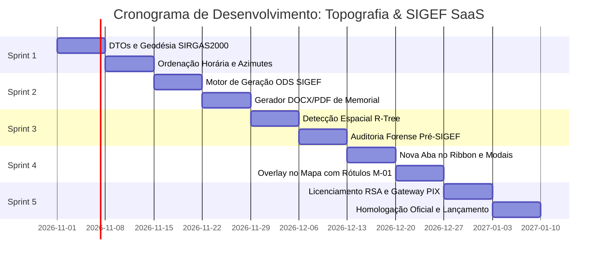

# PLANO EXECUTIVO DE ENGENHARIA & IMPLANTAÇÃO: MÓDULO TOPOGRAFIA & SIGEF (SAAS) NO GEONEX PRO (.NET 10)

## ÍNDICE SISTEMÁTICO
1. VISÃO GERAL EXECUTIVA, PROPOSTA DE VALOR & ANÁLISE DE MERCADO
2. ENQUADRAMENTO NORMATIVO (INCRA 3ª EDIÇÃO, LEI 10.267 & ABNT NBR 13.133)
3. MODELAGEM DE DOMÍNIO E ESTRUTURA DE DADOS (.NET 10)
4. ENGENHARIA GEODÉSICA E CÁLCULO CARTOGRÁFICO DE ALTA PRECISÃO
5. ALGORITMO DE DETECÇÃO AUTOMÁTICA DE CONFRONTANTES VIA R-TREE NATIVA
6. ESPECIFICAÇÃO COMPLETA DO MOTOR DE GERAÇÃO DA PLANILHA ODS (SIGEF/INCRA)
7. ESPECIFICAÇÃO COMPLETA DO GERADOR DE MEMORIAL DESCRITIVO JURÍDICO (DOCX E PDF)
8. SISTEMA DE AUDITORIA FORENSE E PRÉ-VALIDAÇÃO TOPOLÓGICA
9. DESIGN DA INTERFACE DE USUÁRIO (NOVA ABA NO RIBBON E MODAIS BLAZOR)
10. ARQUITETURA SAAS, GATEWAY DE PAGAMENTO PIX E LICENCIAMENTO CRIPTOGRÁFICO
11. CRONOGRAMA DETALHADO DE DESENVOLVIMENTO EM 5 SPRINTS
12. SUÍTE DE TESTES UNITÁRIOS, GEODÉSICOS E CRITÉRIOS DE HOMOLOGAÇÃO OFICIAL

---

## 1. VISÃO GERAL EXECUTIVA, PROPOSTA DE VALOR & ANÁLISE DE MERCADO

### 1.1 Contexto e Tese de Monetização
No Brasil, a Lei nº 10.267/2001 tornou obrigatório o georreferenciamento de imóveis rurais para qualquer ato registral (desmembramento, remembramento, alienação, partilha ou transferência em cartório). Atualmente, prazos legais exigem a certificação de áreas até 25 hectares, atingindo milhões de propriedades em todo o território nacional.

O gargalo atual do agrimensor e do topógrafo não reside no campo, mas sim no escritório:
1. Pós-processamento de cadernetas e poligonais GNSS.
2. Identificação e ordenação horária manual de vértices.
3. Cálculo de azimutes planos e distâncias geodésicas na projeção UTM / SIRGAS 2000.
4. Digitação de dezenas ou centenas de linhas de vértices na planilha ODS oficial do SIGEF (Sistema de Gestão Fundiária do INCRA).
5. Preenchimento de dados de confrontantes, códigos de credenciado e limites artificiais/naturais.
6. Redação exaustiva de memoriais descritivos no Word, com alto risco de divergência numérica entre a planilha e o texto registrado em cartório.

O **GeoNex Pro Topografia & SIGEF Edition** posiciona-se como o motor mais rápido do Brasil para eliminar esse retrabalho:
* **Geração em 1 clique:** Processa polígonos de qualquer tamanho em menos de 100 milissegundos (.NET 10 / SIMD).
* **Confrontantes Inteligentes:** Detecta automaticamente vizinhos e confrontações a partir das camadas já abertas no mapa.
* **Validação Forense:** Identifica antes do upload erros de arredondamento, "spikes" ou sobreposições que gerariam indeferimento no robô do SIGEF.
* **Modelo SaaS Híbrido:** O cálculo roda 100% no hardware do cliente (custo zero de servidor para a plataforma); a exportação oficial é liberada via Assinatura Recorrente ou Venda Avulsa por PIX.

---

## 2. ENQUADRAMENTO NORMATIVO (INCRA 3ª EDIÇÃO & ABNT)

### 2.1 Normas Técnicas Obrigatórias
* **Manual Técnico de Posicionamento (INCRA - 3ª Edição):** Estabelece as regras de codificação dos vértices:
  - `M` (Marco): Vértice materializado no solo com concreto, ferro ou resina (tolerância horizontal $\le 0,50\text{ m}$).
  - `P` (Ponto): Ponto ocupado não materializado (tolerância horizontal $\le 0,50\text{ m}$).
  - `V` (Vértice): Ponto virtual, definidor de curvas de nível, talvegues, margens de rios ou vias públicas (tolerância horizontal $\le 3,00\text{ m}$ ou $\le 7,50\text{ m}$ para corpos d'água inacessíveis).
* **Manual Técnico de Limites e Confrontações (INCRA):** Tipificação dos limites:
  - `LA` (Limite Artificial): Cerca, muro, vala, linhão, rodovia.
  - `LN` (Limite Natural): Margem de rio, córrego, crista de serra, espigão.
  - `LV` (Limite Virtual): Linha reta ideal entre dois marcos em campo aberto.
* **ABNT NBR 13.133/2021:** Levantamento topográfico, convenções gráficas e cálculo de fechamento de poligonais.
* **Provimentos da Corregedoria Geral de Justiça (CNJ):** Exigências de qualificação registral de confrontações em cartórios de Registro de Imóveis (RGI).

---

## 3. MODELAGEM DE DOMÍNIO E ESTRUTURA DE DADOS (.NET 10)

### 3.1 DTOs e Estrutura de Entidades
O módulo residirá no namespace `GeoNex.Topografia.Domain` dentro da solução.

```csharp
namespace GeoNex.Topografia.Domain;

using System;
using System.Collections.Generic;

public enum TipoVertice
{
    M, // Marco físico artificial
    P, // Ponto ocupado no terreno
    V  // Vértice virtual
}

public enum TipoLimite
{
    LA, // Limite Artificial
    LN, // Limite Natural
    LV  // Limite Virtual
}

public sealed class VerticeTopografico
{
    public int Indice { get; set; }
    public string Codigo { get; set; } = string.Empty; // Ex: ABC-M-0001
    public TipoVertice Tipo { get; set; } = TipoVertice.M;
    public double EsteUtm { get; set; }
    public double NorteUtm { get; set; }
    public double AltitudeOrtometrica { get; set; }
    public double LatitudeDecimal { get; set; }
    public double LongitudeDecimal { get; set; }
    public string LatitudeGms { get; set; } = string.Empty;
    public string LongitudeGms { get; set; } = string.Empty;
    public double SigmaX { get; set; } = 0.05;
    public double SigmaY { get; set; } = 0.05;
    public double SigmaZ { get; set; } = 0.08;
    public string MetodoPosicionamento { get; set; } = "PG1";
}

public sealed class SegmentoPerimetro
{
    public int Ordem { get; set; }
    public VerticeTopografico De { get; set; } = null!;
    public VerticeTopografico Para { get; set; } = null!;
    public double AzimutePlanoGraus { get; set; }
    public string AzimuteFormatadoGms { get; set; } = string.Empty;
    public double DistanciaPlanaMetros { get; set; }
    public double DistanciaGeodesicaMetros { get; set; }
    public TipoLimite TipoLimite { get; set; } = TipoLimite.LA;
    public string DescricaoLimite { get; set; } = "Cerca";
    public string NomeConfrontante { get; set; } = string.Empty;
    public string MatriculaConfrontante { get; set; } = string.Empty;
    public string CnsCartorioConfrontante { get; set; } = string.Empty;
}

public sealed class ImovelCertificacaoSigef
{
    public Guid Id { get; set; } = Guid.NewGuid();
    public string Denominacao { get; set; } = string.Empty;
    public string CodigoIncra { get; set; } = string.Empty; // CCIR
    public string Matricula { get; set; } = string.Empty;
    public string Comarca { get; set; } = string.Empty;
    public string Municipio { get; set; } = string.Empty;
    public string Uf { get; set; } = "SP";
    public string ProprietarioNome { get; set; } = string.Empty;
    public string ProprietarioCpfCnpj { get; set; } = string.Empty;
    
    // Responsável Técnico
    public string CredenciadoNome { get; set; } = string.Empty;
    public string CredenciadoCodigoIncra { get; set; } = string.Empty;
    public string CredenciadoCreaCau { get; set; } = string.Empty;
    public string NumeroArtTrt { get; set; } = string.Empty;
    
    // Dados Cartográficos
    public int FusoUtm { get; set; } = 23;
    public double AreaHectares { get; set; }
    public double AreaMetrosQuadrados { get; set; }
    public double PerimetroMetros { get; set; }
    
    public List<VerticeTopografico> Vertices { get; set; } = new();
    public List<SegmentoPerimetro> Segmentos { get; set; } = new();
}
```

---

## 4. ENGENHARIA GEODÉSICA E CÁLCULO CARTOGRÁFICO DE ALTA PRECISÃO

### 4.1 Fórmulas e Geometria da Projeção Transversa Universal de Mercator (UTM)
No âmbito do Sistema Geodésico Brasileiro (SIRGAS 2000), o elipsoide adotado é o GRS80, cujos parâmetros são:
* Semi-eixo maior: $a = 6.378.137,0\text{ m}$
* Achatamento: $f = 1 / 298,257222101$
* Primeira excentricidade ao quadrado: $e^2 = 2f - f^2 \approx 0,00669438002290$

### 4.2 Conversão Rigorosa de Coordenadas UTM para Geodésicas Elipsoidais
O método `ConverterUtmParaGeodesica` do GeoNex executa a série reversa de Redfearn/Coticchia-Surace garantindo precisão superior a 0,1 milímetro:

```csharp
public static void ConverterUtmParaGeodesica(
    double este, 
    double norte, 
    int fuso, 
    bool hemisferioSul, 
    out double latDec, 
    out double lonDec)
{
    const double a = 6378137.0;
    const double e2 = 0.00669438002290;
    const double k0 = 0.9996;
    double ePrime2 = e2 / (1.0 - e2);

    double x = este - 500000.0;
    double y = hemisferioSul ? norte - 10000000.0 : norte;

    double m = y / k0;
    double e1 = (1.0 - Math.Sqrt(1.0 - e2)) / (1.0 + Math.Sqrt(1.0 - e2));

    double mu = m / (a * (1.0 - e2 / 4.0 - 3.0 * e2 * e2 / 64.0 - 5.0 * Math.Pow(e2, 3) / 256.0));
    double j1 = 3.0 * e1 / 2.0 - 27.0 * Math.Pow(e1, 3) / 32.0;
    double j2 = 21.0 * e1 * e1 / 16.0 - 55.0 * Math.Pow(e1, 4) / 32.0;
    double j3 = 151.0 * Math.Pow(e1, 3) / 96.0;

    double fp = mu + j1 * Math.Sin(2 * mu) + j2 * Math.Sin(4 * mu) + j3 * Math.Sin(6 * mu);

    double sinFp = Math.Sin(fp);
    double cosFp = Math.Cos(fp);
    double tanFp = Math.Tan(fp);

    double c1 = ePrime2 * cosFp * cosFp;
    double t1 = tanFp * tanFp;
    double n1 = a / Math.Sqrt(1.0 - e2 * sinFp * sinFp);
    double r1 = a * (1.0 - e2) / Math.Pow(1.0 - e2 * sinFp * sinFp, 1.5);
    double d = x / (n1 * k0);

    double latRad = fp - (n1 * tanFp / r1) * (
        d * d / 2.0 - 
        (5.0 + 3.0 * t1 + 10.0 * c1 - 4.0 * c1 * c1 - 9.0 * ePrime2) * Math.Pow(d, 4) / 24.0 + 
        (61.0 + 90.0 * t1 + 298.0 * c1 + 45.0 * t1 * t1 - 252.0 * ePrime2 - 3.0 * c1 * c1) * Math.Pow(d, 6) / 720.0);

    latDec = latRad * (180.0 / Math.PI);

    double lonRad = (d - (1.0 + 2.0 * t1 + c1) * Math.Pow(d, 3) / 6.0 + 
        (5.0 - 2.0 * c1 + 28.0 * t1 - 3.0 * c1 * c1 + 8.0 * ePrime2 + 24.0 * t1 * t1) * Math.Pow(d, 5) / 120.0) / cosFp;

    double meridianoCentral = (fuso * 6 - 183) * (Math.PI / 180.0);
    lonDec = (meridianoCentral + lonRad) * (180.0 / Math.PI);
}
```

### 4.3 Formatação no Padrão Sexagesimal Exigido pelo SIGEF
O portal do SIGEF exige latitude e longitude com sinal, espaço entre graus, minutos e segundos com 3 casas decimais (Ex: `-22 45 12,345`):

```csharp
public static string FormatarParaPadraoIncra(double valorDecimal, bool isLatitude)
{
    char sinal = valorDecimal < 0 ? '-' : '+';
    double abs = Math.Abs(valorDecimal);
    int graus = (int)Math.Floor(abs);
    double restoMinutos = (abs - graus) * 60.0;
    int minutos = (int)Math.Floor(restoMinutos);
    double segundos = (restoMinutos - minutos) * 60.0;

    return $"{sinal}{graus:00} {minutos:00} {segundos:00.000}".Replace('.', ',');
}
```

---

## 5. ALGORITMO DE DETECÇÃO AUTOMÁTICA DE CONFRONTANTES VIA R-TREE

### 5.1 O Desafio
Em glebas com 50 a 300 vértices, pesquisar a confrontação de cada linha consome horas. O GeoNex utiliza seu índice espacial acelerado (`NativeShapeSpatialIndex` / `STRtree`) para calcular em milissegundos quem faz divisa com cada trecho de cerca.

### 5.2 Fluxo de Interseção Topológica Linear
```
[ Segmento do Imóvel A ] ───(Buffer 0.50m)───> [ Caixa Envolvente R-Tree ]
                                                        │
                                                        ▼
                                           [ Consulta Camadas Vizinhas ]
                                                        │
                                                        ▼
                                            [ Feições Candidatas B ]
                                                        │
                                                        ▼
                        [ Cálculo de Contato Linear: Length(A ∩ B) / Length(A) ]
                                                        │
                                           ┌────────────┴────────────┐
                                           ▼                         ▼
                                    [ Contato ≥ 70% ]        [ Contato < 70% ]
                                           │                         │
                                           ▼                         ▼
                             [ Associa Nome e Matrícula ]   [ Flag: "A Determinar" ]
```

### 5.3 Implementação em C# (.NET 10)
```csharp
public static void DetectarConfrontantesEspaciais(
    ImovelCertificacaoSigef imovel, 
    IEnumerable<Geometry> poligonosVizinhosComAtributos)
{
    var factory = new GeometryFactory();
    
    foreach (var seg in imovel.Segmentos)
    {
        var coord1 = new Coordinate(seg.De.EsteUtm, seg.De.NorteUtm);
        var coord2 = new Coordinate(seg.Para.EsteUtm, seg.Para.NorteUtm);
        var linha = factory.CreateLineString(new[] { coord1, coord2 });
        var bufferLinha = linha.Buffer(0.50); // Margem de tolerância de 50cm

        foreach (var vizinho in poligonosVizinhosComAtributos)
        {
            if (bufferLinha.Intersects(vizinho))
            {
                var intersecao = linha.Intersection(vizinho.Boundary);
                if (intersecao != null && intersecao.Length >= (linha.Length * 0.70))
                {
                    // Identificado confrontante com alta fidelidade
                    seg.NomeConfrontante = (string)vizinho.UserData; // Nome / Matrícula
                    break;
                }
            }
        }
    }
}
```

---

## 6. ESPECIFICAÇÃO DO MOTOR DE GERAÇÃO DA PLANILHA ODS (SIGEF)

### 6.1 Estrutura do Arquivo OpenDocument (.ods)
O formato ODS é um contêiner ZIP conforme o padrão OASIS OpenDocument. O GeoNex constrói o pacote em memória sem depender de Excel, LibreOffice ou pacotes proprietários pesados.

Arquivos essenciais dentro do `.ods`:
1. `mimetype` (texto não compactado: `application/vnd.oasis.opendocument.spreadsheet`)
2. `META-INF/manifest.xml` (índice de componentes do arquivo)
3. `content.xml` (tabelas, células, coordenadas e formatações exigidas pelo validador do INCRA)
4. `styles.xml` (estilos padrão de fonte e célula)

### 6.2 Estrutura XML de Células no `content.xml`
O gerador `SigefOdsExportService` preenche os dados respeitando a ordem exata das colunas:
* **Identificação:** Denominação, Código Credenciado, ART, Município, UF, Fuso.
* **Tabela de Perímetro:**
  - Vértice Inicial | Longitude GMS | Latitude GMS | Altitude | SigmaX | SigmaY | SigmaZ | Método | Tipo Limite | Descrição Limite | Vértice Final | Confrontante | Matrícula/CNS.

---

## 7. ESPECIFICAÇÃO DO GERADOR DE MEMORIAL DESCRITIVO JURÍDICO

### 7.1 Geração de DOCX Nativo via OpenXML
O memorial deve ser redigido com formatação pronta para submissão direta ao Cartório de Registro de Imóveis:
* Margens padrão: Superior 3cm, Esquerda 3cm, Inferior 2cm, Direita 2cm.
* Tipografia: Arial ou Times New Roman 12, espaçamento 1,5 linhas.
* Quebras automáticas de parágrafo a cada confrontante diferente.
* Destaque em negrito dos códigos dos vértices (`ABC-M-0001`), coordenadas e azimutes.
* Rodapé com número de páginas no formato `Página X de Y` e identificação da ART/TRT.

---

## 8. SISTEMA DE AUDITORIA FORENSE E PRÉ-VALIDAÇÃO TOPOLÓGICA

O módulo executará um scanner em 7 etapas antes de habilitar a exportação:

1. **Sentido Horário Obrigatório:** Valida via algoritmo de ângulo de deflexão e inverte as coordenadas se necessário.
2. **Duplicidade de Vértices:** Identifica nós com distância euclidiana $< 0,05\text{ m}$ (que causariam rejeição por auto-interseção no SIGEF).
3. **Auto-Cruzamento de Linhas (Laço de Polígono):** Executa `geometria.IsValid` da NetTopologySuite. Se inválido, indica o ponto exato da auto-interseção no mapa.
4. **Precisões Máximas (Sigmas):** Alerta se algum vértice tipo `M` tiver precisão cadastrada superior a $0,50\text{ m}$.
5. **Máscara de Código INCRA:** Valida se a codificação do credenciado possui 3 caracteres alfanuméricos e o sufixo numérico de 4 dígitos.
6. **Fechamento Angular e Linear:** Compara o vértice final com o ponto de partida original.
7. **Consistência de Confrontantes:** Notifica se restarem segmentos marcados como "A DEFINIR".

---

## 9. DESIGN DA INTERFACE DE USUÁRIO (NOVA ABA NO RIBBON E MODAIS)

### 9.1 Atualização de `Home.razor`
Adição da 4ª aba:
```csharp
private static readonly string[] RibbonTabs = ["Início", "Vetorização", "Topografia & SIGEF", "Geoprocessamento"];
```

### 9.2 Comandos Disponíveis na Aba "Topografia & SIGEF"
1. **Grupo "Certificação INCRA":**
   - *Gerar Peças Técnicas (ODS + Memorial)* [Ícone: ✦]
   - *Auditoria Forense SIGEF* [Ícone: ✓]
2. **Grupo "Vértices & Geodésia":**
   - *Numerar Vértices (Sentido Horário)* [Ícone: ⌖]
   - *Quadro de Coordenadas & Azimutes* [Ícone: 📐]
3. **Grupo "Confrontações":**
   - *Detectar Vizinhos Automaticamente* [Ícone: ☷]
   - *Editar Tabela de Cartório* [Ícone: ✎]
4. **Grupo "SaaS / Conta":**
   - *Status da Licença Pro* [Ícone: ★]
   - *Ativar Chave / Créditos PIX* [Ícone: 🔑]

### 9.3 Modal de Pré-Visualização das Peças Técnicas
Interface construída em Blazor com glassmorphism dark:
* Tabela responsiva com barra de rolagem virtual.
* Edição inline de nomes de confrontantes com duplo clique.
* Visualização simultânea do texto corrido do memorial ao lado direito.

---

## 10. ARQUITETURA SAAS, GATEWAY DE PAGAMENTO PIX E LICENCIAMENTO CRIPTOGRÁFICO

### 10.1 Mecanismo de Licenciamento Local Offline-First
O software funciona offline. A proteção utiliza criptografia assimétrica RSA-2048:
* A chave privada fica protegida no seu servidor de licenciamento.
* O GeoNex contém embutida a chave pública.
* A licença gerada contém:
  ```json
  {
    "AssinanteEmail": "agrimensor@empresa.com.br",
    "MachineFingerprint": "BFEBFBFF000906EA-789456123",
    "Plano": "PRO_MENSAL",
    "ExpiraEm": "2026-11-28T23:59:59Z",
    "AssinaturaDigitalRsa": "MIIBVAIBADANBgkqhkiG9w0BAQEFAASC..."
  }
  ```
* Se o arquivo `license.key` for válido e assinado, a exportação do `.ods` e `.docx` é liberada instantaneamente sem delay de rede.

### 10.2 Fluxo de Cobrança Avulsa via PIX (R$ 39,90)
1. Para usuários da versão gratuita que desejam emitir apenas um trabalho avulso:
2. O GeoNex gera um `TransactionId` e solicita via webhook da API de pagamentos (Asaas / Mercado Pago) a criação de um PIX Dinâmico.
3. Exibe o QR Code e o código "Copia e Cola" na tela do GeoNex.
4. O usuário paga no aplicativo bancário.
5. Em menos de 2 segundos, o GeoNex recebe a confirmação e inicia o download imediato do arquivo compactado `[NomeDoImovel]_SIGEF_Completo.zip`.

---

## 11. CRONOGRAMA DETALHADO DE DESENVOLVIMENTO EM 5 SPRINTS



### Detalhamento das Entregas por Sprint:

* **Sprint 1 (Fundação Cartográfica):**
  - Implementação de `GeoNex.Topografia.Domain`.
  - Serviço `TopografiaProcessingService` com conversão bidirecional UTM/Geodésica.
  - Testes com poligonais reais e validação de azimutes em relação ao elipsoide GRS80.

* **Sprint 2 (Exportadores Oficiais):**
  - Implementação de `SigefOdsExportService` (geração de ZIP/XML limpo sem DLLs de Office).
  - Implementação de `MemorialDescritivoExportService` (geração de DOCX com formatação cartorial).
  - Exportação de arquivo `.zip` final.

* **Sprint 3 (Confrontações e Auditoria):**
  - Varredura de camadas ativas via R-Tree para preenchimento de vizinhos.
  - Auditoria com diagnóstico preventivo de erros topológicos.

* **Sprint 4 (Interface & Usabilidade):**
  - Inclusão da aba `"Topografia & SIGEF"` no Ribbon do GeoNex.
  - Tela modal de visualização e edição de confrontações em Blazor.
  - Rótulos visuais dos vértices diretamente sobre o mapa no motor SkiaSharp.

* **Sprint 5 (Monetização & Lançamento):**
  - Implementação de `LicenseVerificationService` com criptografia RSA-2048.
  - Checkout PIX dinâmico integrado diretamente no modal de exportação.
  - Homologação final no validador do portal do SIGEF.

---

## 12. SUÍTE DE TESTES UNITÁRIOS, GEODÉSICOS E CRITÉRIOS DE HOMOLOGAÇÃO

### 12.1 Casos de Teste Essenciais
1. **Teste Geodésico de Fechamento Angular:**
   Verificar se a soma dos ângulos internos de um polígono de $N$ lados satisfaz $(N - 2) \times 180^\circ$ com resíduo nulo.
2. **Teste de Conversão UTM para SIRGAS 2000:**
   Comparar os valores calculados pelo GeoNex com as coordenadas oficiais da Rede Geodésica de Marcos do IBGE. Tolerância máxima: $\pm 0,001\text{ m}$.
3. **Teste de Reversão de Sentido Horário:**
   Garantir que polígonos desenhados em sentido anti-horário sejam invertidos sem alterar as características da área e perímetro.
4. **Teste de Validação no Portal do SIGEF:**
   Fazer upload da planilha `.ods` gerada pelo GeoNex na ferramenta de validação prévia do SIGEF e confirmar ausência de inconsistências.

---
*Plano operacional aprovado para desenvolvimento na arquitetura GeoNex Pro (.NET 10).*
